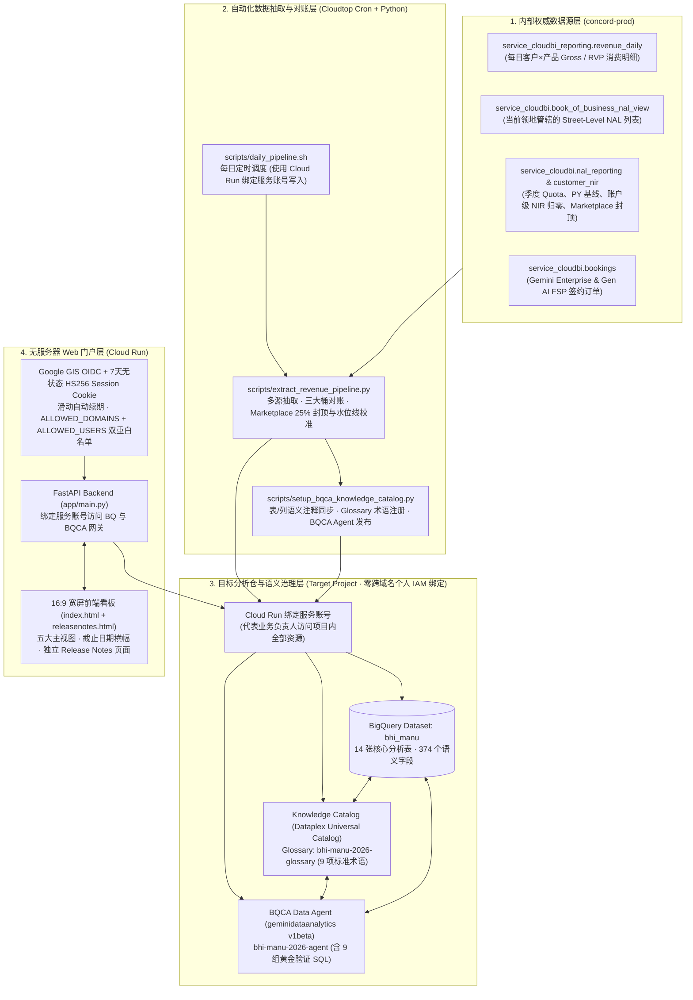
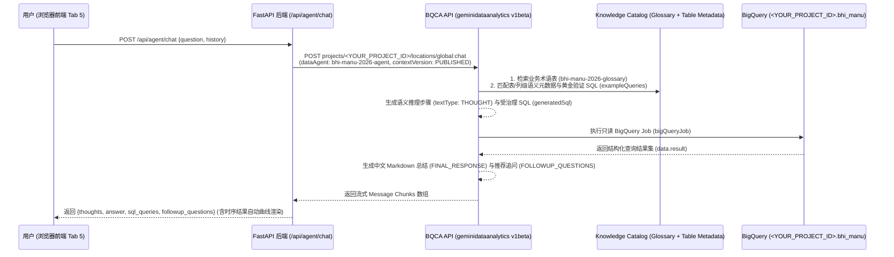
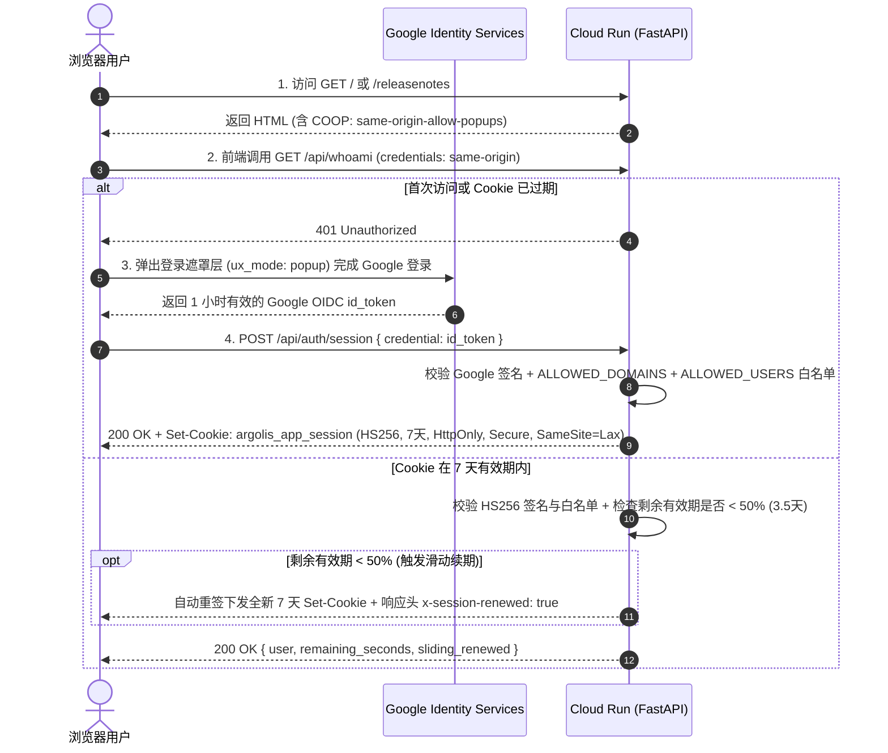

# 软件设计说明书 (SDD v1.13)：2026 行业线收入、RunRate 与三大桶 Quota 达成门户（含 BQCA + Knowledge Catalog 智能分析引擎、独立 Project 级 MRR/DRR 曲线专区、GE Subscriptions 真实席位数校准、无状态长效认证 & 四级缓存加速架构）

- **文档版本**：`v1.13 (Production Release)`
- **更新日期**：`2026-10-16`
- **适用范围**：`Google Cloud 区域与行业线 (BHI / Manufacturing 等领地可通用复用)`
- **目标 GCP 项目与数据集**：`<YOUR_PROJECT_ID>.<YOUR_DATASET>`（示例：`bhi_manu`）
- **BQCA Data Agent 资源**：`projects/<YOUR_PROJECT_ID>/locations/global/dataAgents/bhi-manu-2026-agent`
- **Knowledge Catalog 术语表**：`projects/<YOUR_PROJECT_ID>/locations/global/glossaries/bhi-manu-2026-glossary`
- **语言版本 (Language Editions)**：**中文版 (SDD_cn.md)** | [English Edition (SDD_en.md)](./SDD_en.md)

---

## 1. 系统背景与设计目标 (Executive Summary)

### 1.1 业务痛点
在 Google Cloud 区域与行业线的日常经营分析中，销售负责人与 Customer Engineer (CE) 面临以下核心痛点：
1. **多源口径割裂**：日常消费出账数据位于 `concord-prod.service_cloudbi_reporting.revenue_daily` 与项目级 `revenue_project_sku_daily`，而三大考核桶 Quota、去年同期基线（PY Baseline）、账户级负向归零（NIR Floor）以及 Gemini Enterprise (GE) 合同签约（Bookings Net ACV）分散在 `concord-prod.service_cloudbi` 的多张视图中。
2. **RVP 认账、Gross 毛消费与 Marketplace 封顶规则复杂**：销售考核以含激励折算的 **RVP Revenue** 为准（其中 3P Marketplace 按 50% 折算），且在 Bucket 1 中受 **25% Marketplace Quota Cap** 限制，在 Bucket 2 中仅计入 **1P 自研产品**（剔除 3P Marketplace AI 订阅），直接裸查明细表极易与 `go/rainmaker` 产生偏差。
3. **GE 签约水位线（Monthly Watermark）对账困难**：Gemini Enterprise 采用签约净增年化合同额（`NETACV_MONTHLY`）考核，从客户 100% 原始签约额到 `go/rainmaker` 最终认账达成之间涉及续约剔除、`Gen AI FSP` 10% 权重折算以及历史最高水位线冲减三步核算。
4. **隐私与组织安全合规要求**：
   - 直接查询个人级薪酬快照表会涉及个人敏感薪酬信息（PII / Compensation），需要构建一套**100% 领地级（Territory）与街区级（Street-Level NAL）脱敏汇总架构**，不存储任何个人薪酬字段；
   - 遵循 Argolis 组织安全策略（Domain Restricted Sharing），项目 IAM 严禁直接绑定跨域名个人邮箱账号，需统一由 Cloud Run 绑定的专用 Service Account 代理访问后端资源；
   - 原生 Google Identity Services (GIS) OIDC `id_token` 固定 1 小时（3600 秒）硬性过期，导致业务人员看看板时每小时频繁掉线重登。
5. **长尾与 Project 级细粒度曲线查询响应慢**：固定报表难以覆盖临时的跨表组合查询或基于单个 **GCP Project ID (`project_id`)** 的月度 MRR 与每日 DRR 趋势曲线下钻（如查询 `vivocloudai`、`oppo-gcp-prod-159055` 或 `ai-mify-pt-1` 的爬坡与掉量走势），传统 LLM 裸写 SQL 容易搞错内部考核口径且缺乏自动曲线可视化能力。

### 1.2 核心设计目标
- **口径 100% 对齐 `go/plan2100` 与 `go/rainmaker`**：自动完成 Bucket 1 (`GCP iRevenue`)、Bucket 2 (`DA, DB & Cloud AI iRevenue`)、Bucket 3 (`Gemini Enterprise Net ACV`) 的领地级与各 Street-Level NAL 级精确对账（含账户级负向归零、Marketplace 25% Quota Cap、Bucket 2 1P-Only 过滤及对账截止日期显式标注）。
- **无状态长效 Session（7天有效）+ 滑动自动续期访问控制 + 未登录前零信息暴露**：将 Google 1 小时 `id_token` 换发为应用自签名的 7 天无状态 `HS256` `HttpOnly` Session Cookie，剩余有效期低于 50% 时自动滑动续期；未通过登录验证前服务端仅下发 3.4 KB 零业务信息登录壳页面（Zero Pre-Login Information Exposure），不暴露任何业务 DOM、指标名称或白名单账号。
- **前后端四级缓存加速架构（0ms 刷新秒开 + 5 步动态进度条）**：结合浏览器 `localStorage` 全量快照缓存（L1，6 小时 TTL + SWR 静默版本比对）、`sessionStorage` 每日 DRR 趋势曲线缓存（L2，切换 RVP/Gross 视图 `0ms` 重绘）、后端多线程并发查询与 1 小时内存缓存（L3）以及顶栏一键强制穿透刷新按钮（L4），彻底消除每次刷新重复查询 BigQuery 的等待；首次冷加载时展示 5 步实时数据计算进度条，避免加载期间出现 `$0` 占位符。
- **三层汇总与三层级每日 RunRate 曲线下钻（NAL 级 + Account 级 + 独立 GCP Project ID 级顶层专区）**：同时提供 **NAL 级（第一层，业务组汇总）**、**Account 级（第二层，客户明细）** 以及独立的 **Tab 5「🔍 Project 级 MRR & DRR 曲线」顶层专区（第三层，覆盖全领地 5,078 个命名 GCP Project，含 Top 300 项目交互式计分卡表格与双曲线联动）** 的月度 MRR 与每日 **单日 RunRate (DRR)** 走势曲线。
- **BQCA + Knowledge Catalog 语义治理长尾分析 + 过去两周新签 GE 订单明细 + 对话气泡内自动曲线渲染**：基于 Google Cloud 原生 **BigQuery Conversational Analytics (`geminidataanalytics.googleapis.com/v1beta`)** 与 **Knowledge Catalog (`dataplex.googleapis.com/v1`)**，将 15 张表 / 396 列语义描述（含逐笔订单流水表 `customer_ge_orders_2026` 及关联 `subscriptions.metric_quantity` 校准的真实授权席位数 `seats`）、9 项官方业务术语及 10 组黄金验证 SQL 注入受治理的 Data Agent，并在前端实现 **时序结果集自动检测与 Chart.js 交互式折线/柱状图内嵌渲染**。
- **全量变更可审计（Release Notes）与一键复制重现**：内置独立版本更新日志页面（`/releasenotes`，记录 `v1.0.0` 至 `v1.13.0` 完整变更），其他行业线或区域团队仅需修改项目配置与领地 NAL 范围，即可在 15 分钟内完整克隆部署。

---

## 2. 端到端系统架构 (System Architecture)



---

## 3. 代码仓库目录结构 (Repository Structure)

```text
manu-bhi/
├── SDD_cn.md                                # 中文版软件设计说明书 (Current Version: v1.11)
├── SDD_en.md                                # 英文版软件设计说明书 (English Edition for Global Teams: v1.11)
├── skills/
│   ├── cloudrun-session-domain-auth/
│   │   └── SKILL.md                         # Cloud Run 无状态长效 Session (7~30天) + 滑动自动续期认证 Skill 规范
│   └── cloudrun-session-domain-auth.zip     # 独立打包的 Skill 压缩包（可直接解压至 ~/.gemini/config/skills/ 复用）
├── scripts/
│   ├── extract_revenue_pipeline.py          # 核心 ETL 管线：从 concord-prod 抽取并构建 11 张分析表（通过服务账号写入）
│   ├── setup_bqca_knowledge_catalog.py      # 语义治理脚本：通过服务账号同步 Knowledge Catalog 表/列注释、Glossary 与 BQCA Agent
│   └── daily_pipeline.sh                    # 每日定时刷新脚本（由 crontab 每日自动触发 ETL + 语义同步）
├── app/
│   ├── Dockerfile                           # Cloud Run 容器镜像构建文件 (Python 3.12-slim + uvicorn)
│   ├── requirements.txt                     # Web 后端 Python 依赖清单 (含 FastAPI, PyJWT, google-auth, BigQuery)
│   ├── main.py                              # FastAPI 后端服务（含 7天无状态 Session 鉴权、四级缓存 API、并发查询、BQCA 网关）
│   └── templates/
│       ├── index.html                       # 16:9 宽屏主看板（localStorage 0ms 秒开缓存 + 5步加载进度条 + 双层 DRR 曲线 + BQCA 对话框）
│       └── releasenotes.html                # 独立版本更新日志页面（记录 v1.0.0 至 v1.11.0 历次版本演进，支持分类筛选与搜索）
└── logs/
    └── cron.log                             # 每日定时任务执行日志
```

---

## 4. 核心业务口径与对账算法规范 (`go/plan2100` & `go/rainmaker`)

### 4.1 收入与 RunRate 基础定义
| 术语名称 | 字段命名规范 | 业务定义与计算公式 |
| :--- | :--- | :--- |
| **RVP Revenue (销售认账收入)** | `*_rvp_*` | 计入销售业绩考核（含商务激励 Incentives / Credits 折算系数）的净认账收入。**系统默认展示口径**。 |
| **Gross Revenue (毛消费出账收入)** | `*_gross_*` | 客户在 GCP 控制台实际产生的原始账单毛消费额（未乘以激励折算系数）。 |
| **Daily Run Rate (DRR, 单日 RunRate)** | `*_drr` / `*_drr_7d_avg` | 客户或 NAL 在单个自然日产生的云消费金额（USD/day）。默认取最新完整出账日（`T-2`）单日值，并提供近 7 日移动均值平滑周末波动。 |
| **Monthly Run Rate (MRR, 自然月累计 RunRate)** | `*_mrr` | 按自然月日历（如完整上月或当月 MTD）实际消费汇总的自然月累计 RunRate（**严禁做单日 ×30 的人工外推**）。 |
| **日历时间进度基准 (Calendar Prorated Benchmark)** | 前端动态计算 | `年初至今已过天数 / 全年总天数 (365)`，用于衡量年度 Quota 达成率是否超前于日历时间进度。 |

### 4.2 四大核心产品线在 `revenue_daily` 中的分类规则
在 `scripts/extract_revenue_pipeline.py` 中，基于 `go/plan2100` 产品层级映射如下：
1. **GCP 总盘 (`is_gcp_plan2100`)**：
   - `fph_product_level_1 = 'Google Cloud Platform'`（涵盖 Compute、Storage、Networking、Data Analytics、Databases、Cloud AI、Apigee、Cloud Marketplace 等全部计入 GCP 考核的产品）。
2. **Cloud AI (`is_cloud_ai_plan2100`)**：
   - `fph_product_level_2 IN ('Vertex AI', 'Cloud AI')` 或 `gtm_product_level_5 IN ('Build with AI', 'Customer Engagement', 'Developer AI Assistance')`。
3. **DA 数据分析 (`da_*`)**：
   - `fph_product_level_2 IN ('Data Analytics', 'Looker')` 或 `gtm_product_level_5 IN ('Analytics', 'Looker')`（对应 BigQuery、Dataflow、Dataproc、Pub/Sub、Looker 等）。
4. **DB 数据库 (`db_*`)**：
   - `fph_product_level_2 = 'Databases'` 或 `gtm_product_level_5 = 'Migrate and Modernize Databases'`（对应 Spanner、AlloyDB、Cloud SQL、Bigtable、Memorystore、Firestore 等）。

### 4.3 三大考核桶 (Three Quota Buckets) 与 Marketplace 限制对账算法
1. **Bucket 1: GCP iRevenue (增量收入)**
   - **产品范围 (`service_cloudbi.nal_reporting`)**：`product IN ('GCP_CLASSIC_FIELD', 'INFRA_AI', 'AI_SOLUTIONS', 'DEVELOPER_AI_ASSISTANCE', 'APIGEE')`。
   - **核心计算公式**：
     $$\text{Incremental Quota} = \text{Gross Quota} - \text{PY Baseline}$$
     $$\text{Attainment \%} = \frac{\text{YTD Incremental Actuals}}{\text{Incremental Quota}} \times 100\%$$
   - **账户级负向归零规则 (`ApplyAccountNegativeAttainmentToNetZeroRule`)**：从 `service_cloudbi.customer_nir` 按单客户汇总年度净增 `b1_nir`，若单客户同比萎缩（`b1_nir < 0`），按 `GREATEST(b1_nir, 0)` 归零，不倒扣同 NAL 下其他正向增长客户的业绩。
   - **Cloud Marketplace 三重考核限制规则 (`go/plan2100`)**：
     1. **50% RVP 折算系数 (`0.5x`)**：客户通过 Cloud Marketplace 采购第三方（3P）SaaS 或模型订阅时，`rvp_revenue` 默认按 Gross 账单金额的 **50%** 折算计入净消费；
     2. **Bucket 1 的 25% Marketplace Quota Cap**：同一 NAL 下所有 3P Marketplace 产生的净增量收入（Marketplace NIR）计入 Bucket 1 实绩的上限为该 NAL **Bucket 1 年度增量 Quota 的 25%**，超出部分在 `go/rainmaker` 最终认账时自动截断：
        $$\text{Recognized Marketplace NIR} = \min\left(\text{Raw Marketplace NIR},\; 0.25 \times \text{Bucket 1 Incremental Quota}\right)$$
     3. **单账户 iRevenue 封顶规则（Account Cap）**：在 Core FSR/CE Plan 中，单账户对同一考核桶的净增贡献上限为该桶年度增量 Quota 的 `200%`（最低保底封顶线为 `$2.5M`，即 $\max(2.0 \times \text{Quota}, \$2.5\text{M})$）；而在 Select / Enterprise Plan 中不设单账户 200% 封顶，但仍严格执行上述 25% Marketplace Quota Cap。
2. **Bucket 2: DA, DB & Cloud AI iRevenue (数据与 AI 增量收入)**
   - **产品范围 (`service_cloudbi.nal_reporting`)**：`product IN ('ANALYTICS', 'LOOKER', 'MIGRATE_AND_MODERNIZE_DATABASES', 'AI_SOLUTIONS', 'DEVELOPER_AI_ASSISTANCE')`。
   - **1P 自研产品限定规则（剔除 3P Marketplace）**：虽然 `customer_nir` 中部分第三方 Marketplace 模型订阅会被打上 `gtm_product_level_5 = 'Build with AI'` 标签，但根据 `go/plan2100` 规范，Bucket 2 仅统计 Google **1P 原生数据与 AI 产品**（`fph_product_level_2 IN ('Vertex AI', 'Cloud AI', 'Data Analytics', 'Looker', 'Databases')`），所有 `fph_product_level_2 = 'Cloud Marketplace'` 的 3P 消费均不计入 Bucket 2 达成。
   - **子领地先锁后分摊规则（Sub-Pod Lock-Before-Allocate Rule）**：在将 Sub-Pod 聚合实绩（如 Sub-Pod 1 / Sub-Pod 2）向 Street-Level NAL 分摊时，必须**先锁定并扣除已确认存在 25% Marketplace Cap 截断或 1P 独立核定的代表精确值**，再将子领地剩余的 1P 净增实绩按 `customer_nir` 1P 权重分配给同组其余 NAL，严禁先按含 3P 的原始权重分摊后再单方面下调某代表数值（否则会导致其余 NAL 的合法 1P 实绩被吞没）。同时自动同步 Q4 领地 Quota 调整（如 Manu Cluster 全领地 Bucket 1 iRev Quota 为 `$78,952,908.00`、实绩 `$73,719,191.25 / 93.37%`；Bucket 2 iRev Quota 为 `$51,653,090.00`、实绩 `$41,668,607.68 / 80.67%`）。
3. **Bucket 3: Gemini Enterprise Net ACV (签约净增年化合同额)**
   - **数据源**：`concord-prod.service_cloudbi.bookings`（**不加 T-2 延迟过滤**，实时同步截至当日的最新已签合同）与 `nal_reporting` (`product = 'AGENTSPACE'`)。
   - **三步对账桥梁（Three-Step Reconciliation Bridge）**：
     - **Step 1（原始 100% 签约年化总额 `signed_acv`）**：汇总 `product_l3 IN ('Gemini Enterprise', 'Gen AI FSP')` 的客户合同原始 ACV；
     - **Step 2（剔除续约 & FSP 10% 折算后 `pre_watermark_net_iacv`）**：
       - 剔除续约合同 `comp_renewal_acv`（续约不计入净增 Net ACV）；
       - `product_l3 = 'Gen AI FSP'` 按 `go/plan2100` 规则以 **10% 权重**折算（即核减 90% 的 FSP 原始签约额）：
         $$\text{Pre-Watermark Net iACV} = \text{New/Expansion GE ACV} \times 100\% + \text{New/Expansion FSP ACV} \times 10\%$$
     - **Step 3（扣除 `NETACV_MONTHLY` 月度历史水位线与退订冲减 `watermark_adjustment`）**：
       - 对齐 `service_cloudbi.nal_reporting` (`product = 'AGENTSPACE'`, `quota_metric_Basis = 'NETACV_MONTHLY'`)，扣除月度历史最高水位线（Monthly Watermark）与退订冲减额，得到与 `go/rainmaker` 100% 一致的最终认账达成（`rainmaker_final_attainment`）。
     - **Step 4（GE 授权席位数 `total_seats` / `seats` 的 Subscriptions 联合校准算法）**：
       - 在 `concord-prod.service_cloudbi.bookings` 中，仅 Salesforce CPQ 线下合同（`order_number` 以 `006...` 开头）在 `bookings.quantity` 字段直接记录授权席位数；而所有通过 Console / 自助通道下单的月度或年度订阅合同（`subscription_id` 为 UUID，如 `vivo Mobile Communication Co., Ltd` 的月度 Plus 订阅），`bookings.quantity` 固定记为 **`1`**（代表 1 份订阅合同行，而非 1 个 Seat）。
       - 系统通过 `b.subscription_id = s.subscription_id` 关联 `concord-prod.service_cloudbi.subscriptions` 最新分区的 `metric_quantity` 字段获取真实授权席位数（`COALESCE(s.metric_quantity, b.quantity)`），并在客户汇总表 `customer_ge_bookings_2026` 中按唯一合同键 `COALESCE(subscription_id, order_number)` 去重汇总有效席位数（避免按月账单行重复累加席位），同时在逐笔订单表 `customer_ge_orders_2026` 中记录每一笔新签订单的真实席位数（如 `2026-10-10` `jadenwang` 下 `vivo` 订单为 `324 席 / $19,647.00`）。

---

## 5. 目标数据仓模型设计 (`<YOUR_PROJECT_ID>.bhi_manu` 15 张表)

| 序号 | 表名 (Table ID) | 粒度 (Grain) | 核心用途与对应前端视图 |
| :---: | :--- | :--- | :--- |
| 1 | `customer_revenue_scorecard_2026` | `reporting_id` (客户级) | 客户级 YTD RVP/Gross 收入（GCP/AI/DA/DB/GE）、最新单日 DRR、7 日均值、当月/上月 MRR（Tab 1 & Tab 2 第二层表） |
| 2 | `nal_revenue_scorecard_2026` | `nal_name` (NAL 级) | NAL 级 YTD RVP/Gross 收入、最新单日 DRR、当月/上月 MRR 及 AI 渗透率（Tab 1 & Tab 2 第一层表） |
| 3 | `customer_monthly_revenue` | `reporting_id × year_month` | 客户×月度累计 RunRate (MRR) 与当月日均 DRR（月度趋势图 & MoM 分析） |
| 4 | `customer_daily_runrate` | `reporting_id × usage_date` | 年初至今（截至 T-2）每日单日 RunRate (DRR)、MTD 累计与 7 日移动平均（支持 NAL 级与客户级双层每日曲线） |
| 5 | `customer_ge_bookings_2026` | `reporting_id × sku_description` | Gemini Enterprise & Gen AI FSP 客户签约订单汇总、经 `subscriptions.metric_quantity` 校准的真实有效席位数 (`total_seats`)、最近一笔订单席位数 (`latest_order_seats`)、TCV、100% Signed ACV 与折算后 Net iACV（Tab 3 第二层表） |
| 6 | `customer_ge_orders_2026` | `booking_date × order_number` | **GE 逐笔订单明细流水表**：记录每一笔 GE 订单的精确下单日期 (`booking_date`)、销售代表 NAL、客户、SKU、校准后真实授权席位数 (`seats`) 与单笔 ACV（支持「过去两周新下单的 GE」等高频长尾查询） |
| 7 | `nal_ge_bookings_2026` | `nal_name` (NAL 级) | 按 NAL 汇总 GE 签约客户数、校准后真实总席位数、原始签约额、水位线前 Net iACV 与 Rainmaker 最终认账额（Tab 3 第一层表） |
| 8 | `ge_monthly_bookings_2026` | `year_month` (月度级) | 按月汇总 GE 新签 (New)、扩容 (Expansion)、续约 (Renewal) 与净增走势（Tab 3 月度柱状图） |
| 9 | `nal_three_buckets_quota_2026` | `nal_id` (一线 NAL) | **核心考核对账表**：各 NAL 在三大桶的去年同期基线、年度全量/增量 Quota、实际达成与达成率（顶栏 Banner & Tab 4） |
| 10 | `territory_quarterly_quota_2026` | `quarter × product` | Q1–Q4 分季度、分考核产品线的基线、Quota 与实绩明细（Tab 4 第三部分） |
| 11 | `customer_product_revenue_daily` | `reporting_id × usage_date × fph_l3` | 细粒度客户每日产品子项消费明细，供深度下钻查询 |
| 12 | `customer_ge_details_2026` | `reporting_id × fph_l5` | 账单侧 GE 相关子产品出账明细 |
| 13 | `project_revenue_scorecard_2026` | `project_id × billing_account_id` | **GCP Project 级计分卡**：覆盖全领地 5,414 个 Project 的 YTD 收入、9月/10月 MRR、最新单日 DRR 与 7 日均值（Tab 5 独立专区 & BQCA） |
| 14 | `project_monthly_revenue` | `project_id × year_month` | **GCP Project 级自然月 MRR 表**：全部 5,414 个 Project 在 2026-01 至 2026-10 的月度 MRR 与日均 DRR 走势曲线 |
| 15 | `project_daily_runrate` | `project_id × usage_date` | **GCP Project 级每日 DRR 曲线表**：按 `usage_date` 分区、`project_id` 聚簇，记录活跃 Project 的每日 DRR 曲线与 7 日移动均线 |

---

## 6. BQCA + Knowledge Catalog 语义治理层设计

本系统摒弃了传统“在 Prompt 中硬塞表结构让通用大模型盲写 SQL”的做法，采用 Google Cloud 原生 **BQCA (`geminidataanalytics.googleapis.com/v1beta`) + Knowledge Catalog (`dataplex.googleapis.com/v1`)** 三层语义治理架构（详见 `scripts/setup_bqca_knowledge_catalog.py`）：



### 6.1 第一层：BigQuery 表与列级语义元数据自动同步
- `update_bigquery_knowledge_catalog_metadata()` 遍历 `bhi_manu` 下全部 14 张表，通过 `bq_client.update_table(table, ["description", "labels", "schema"])` 写入每张表的业务定位与全部 **374 个列**的中英文口径说明。
- BigQuery 自动将这些元数据同步至 **Dataplex Universal Catalog (Knowledge Catalog)** 的 `@bigquery` 资产条目中，并在每日 `extract_revenue_pipeline.py` 跑批结束时自动重刷，确保 `WRITE_TRUNCATE` 不会丢失字段注释。

### 6.2 第二层：Knowledge Catalog 受治理业务术语表 (`bhi-manu-2026-glossary`)
- 通过 Dataplex API (`https://dataplex.googleapis.com/v1/projects/<YOUR_PROJECT_ID>/locations/global/glossaries/bhi-manu-2026-glossary`) 注册了 9 个标准业务术语词条（含中英文同义词标签）：
  - `rvp-revenue` (`RVP Revenue (销售认账收入)`)
  - `gross-revenue` (`Gross Revenue (毛消费出账收入)`)
  - `bucket-1-gcp-irevenue` (`Bucket 1: GCP iRevenue`)
  - `bucket-2-dadbai-irevenue` (`Bucket 2: DA, DB & Cloud AI iRevenue`)
  - `bucket-3-ge-net-acv` (`Bucket 3: Gemini Enterprise Net ACV`)
  - `ge-watermark-reconciliation` (`GE Watermark Reconciliation 对账桥`)
  - `daily-run-rate-drr` (`Daily Run Rate (DRR, 单日 RunRate)`)
  - `monthly-run-rate-mrr` (`Monthly Run Rate (MRR, 自然月累计 RunRate)`)
  - `gcp-project-billing-grain` (`GCP Project ID & Billing Account Grain (Project 级细粒度 MRR/DRR 曲线)`)

### 6.3 第三层：BQCA Data Agent (`bhi-manu-2026-agent`) 上下文配置
- 通过 `https://geminidataanalytics.googleapis.com/v1beta/projects/<YOUR_PROJECT_ID>/locations/global/dataAgents/bhi-manu-2026-agent` 发布 `publishedContext`，包含：
  - `datasourceReferences.bq.tableReferences`：绑定 12 张核心查询表（含 `project_revenue_scorecard_2026`、`project_monthly_revenue`、`project_daily_runrate`）及 `schema.fields`、`synonyms`、`tags`；
  - `glossaryTerms`：内嵌 9 项标准术语；
  - `exampleQueries`：9 组经过人工核验的黄金 SQL 问答对（Verified Queries，含按 `project_id` 查询月度 MRR 与每日 DRR 曲线）；
  - `systemInstruction`：规范中文 Markdown 输出格式、默认 RVP 口径、三大桶对账规则及 Project 级时序曲线查询约定。

---

## 7. 无状态长效 Session 认证架构、后端 API 与前端交互设计

### 7.1 无状态长效 Session（7天有效）+ 滑动自动续期方案 (`cloudrun-session-domain-auth`)
为彻底解决 Google Identity Services (GIS) OIDC `id_token` 固定 1 小时（3600 秒）过期导致频繁掉线的问题，同时无需额外部署 ALB 负载均衡器或 Redis，本系统在 `app/main.py` 中实现了无状态长效会话管理：



- **核心工程防踩坑设计**：
  1. **自定义分号 Cookie 解析器 (`extract_cookie_token`)**：GIS SDK 会在同域下写入包含花括号与双引号的 `g_state={"i_l":0}` Cookie，会导致 Python 标准库 `http.cookies.SimpleCookie`（进而影响 `request.cookies`）解析中断并丢失其后的 Session Cookie；后端直接按 `;` 拆分原始 `Cookie` 请求头安全提取 `argolis_app_session`。
  2. **COOP 响应头与 Popup 模式**：所有页面响应头显式设置 `cross-origin-opener-policy: same-origin-allow-popups`，前端 GIS 初始化固定采用 `ux_mode: 'popup'` 并配合 `setTimeout(..., 80)` 渲染按钮，避免 Google 弹窗 `postMessage` 被浏览器拦截。
  3. **Scale-to-Zero 与多实例无状态兼容**：所有会话声明（`sub`, `email`, `name`, `iat`, `exp`, `type`）经环境变量 `SESSION_SECRET` 进行 `HMAC-SHA256` 签名存储在客户端 `HttpOnly` Cookie 中，容器缩容至 0 或多实例水平扩容均不会丢失登录状态。
  4. **未登录前零信息暴露（Zero Pre-Login Information Exposure）**：当未持有有效 `argolis_app_session` Cookie 的请求访问 `/` 或 `/releasenotes` 时，服务端直接返回仅 `3.4 KB` 的纯净登录网关壳（`_get_unauth_login_html`），且受保护前端 DOM 树包裹在默认隐藏的 `#appProtectedShell { display: none }` 中，确保未通过认证前不泄露任何业务指标名称、客户数据或白名单账号。

### 7.2 后端 API 路由契约与四级缓存加速架构 (`app/main.py`)
所有 `/api/*` 业务接口均受 `Depends(require_session)` 保护，并结合 **前后端四级缓存架构（L1 `localStorage` 6h 快照 + L2 `sessionStorage` DRR 趋势缓存 + L3 后端 `ThreadPoolExecutor(max_workers=8)` 与 1 小时 `_DATA_CACHE` + L4 一键强制穿透刷新）**：

| HTTP 方法与路径 | 功能说明 | 核心底层表 / 缓存策略 |
| :--- | :--- | :--- |
| `GET /` | 返回主看板 HTML（未登录返回 3.4 KB 纯净登录壳；含 `COOP: same-origin-allow-popups`） | `app/templates/index.html` |
| `GET /releasenotes` | 返回独立版本更新日志 HTML 页面（记录 `v1.0.0` → `v1.11.0` 完整变更） | `app/templates/releasenotes.html` |
| `GET /authconfig` | 返回前端 GIS 登录所需的 `client_id` 与 `session_ttl_seconds`（不暴露白名单信息） | 环境变量配置 |
| `POST /api/auth/session` | 验证前端提交的 1 小时 Google `id_token`，签发 7 天 `HttpOnly` Session Cookie | `google.oauth2.id_token` + `PyJWT` |
| `GET /api/whoami` | 校验当前长效 Session 状态（若剩余有效期 `< 50%` 自动滑动续期） | `require_session` |
| `POST /api/auth/logout` | 清除 `argolis_app_session` Cookie 并清空浏览器端本地缓存快照 | Cookie & Cache 销毁 |
| `GET /api/overview` | 返回全领地 YTD RVP/Gross KPI、最新单日 DRR 与当月/上月 MRR（支持 `?refresh=1`） | `_DATA_CACHE["overview"]` (1h TTL) + 前端 `localStorage` |
| `GET /api/quota-attainment` | 返回 12 个 NAL 三大桶 Quota 达成对账、分季度 Quota 与对账截止时间元数据 | `_DATA_CACHE["quota_attainment"]` (1h TTL) + 前端 `localStorage` |
| `GET /api/scorecard` | 并行查询并返回 12 个 NAL 汇总计分卡与 238 家重点客户明细计分卡 | `_DATA_CACHE["scorecard"]` (1h TTL) + 前端 `localStorage` |
| `GET /api/monthly` | 返回 2026 各自然月 MRR 与产品支柱趋势 | `_DATA_CACHE["monthly"]` (1h TTL) + 前端 `localStorage` |
| `GET /api/ge-stats` | 并行查询并返回 GE 客户订单明细、NAL 汇总与月度签约走势 | `_DATA_CACHE["ge_stats"]` (1h TTL) + 前端 `localStorage` |
| `GET /api/nal-trend?nal_name=...` | 返回指定 NAL（或全领地 `ALL`）2026 每日单日 RunRate (DRR) 序列（同时含 RVP 与 Gross） | `_DATA_CACHE["nal_trend:*"]` (1h TTL) + 前端 `_nalTrendCache` |
| `GET /api/customer-trend?reporting_id=...` | 返回指定客户 2026 每日单日 RunRate (DRR) 序列（同时含 RVP 与 Gross） | `_DATA_CACHE["cust_trend:*"]` (1h TTL) + 前端 `_custTrendCache` |
| `GET /api/projects/top` | 返回 Top GCP Projects 列表（含 YTD RVP/Gross、9月/10月 MRR、最新单日 DRR）与全领地项目汇总统计 | `_DATA_CACHE["projects_top:*"]` (1h TTL) |
| `GET /api/project-trend?project_id=...` | 返回任意 `project_id` / `project_number` 的计分卡元数据、2026 自然月度 MRR 序列与 2026 每日 DRR 曲线序列 | `_DATA_CACHE["proj_trend:*"]` (1h TTL) + 前端 `_projTrendLocalCache` |
| `GET /api/cache/status` | 轻量级（`<5ms`）返回当前后端缓存状态与 BigQuery 表最后修改时间，供前端 SWR 静默比对 | 内存元数据直读 |
| `POST /api/cache/clear` | 一键清空后端全部内存缓存，配合前端 `?refresh=1` 强制从 BigQuery 重新计算 | `_DATA_CACHE.clear()` |
| `GET /api/agent/catalog` | 返回当前绑定的 BQCA Data Agent 与 Knowledge Catalog 治理资产元数据 | `geminidataanalytics` & `dataplex` 配置 |
| `POST /api/agent/chat` | 调用 BQCA `:chat` 接口，返回语义推理步骤 (`thoughts`)、Markdown 回答 (`answer`)、执行的 SQL 与结果 (`sql_queries`) 及推荐追问 (`followup_questions`) | `geminidataanalytics.googleapis.com/v1beta` |

### 7.3 前端 16:9 宽屏与交互亮点 (`app/templates/index.html` & `releasenotes.html`)
1. **16:9 宽屏自适应布局**：主容器采用 `max-width: 98vw`，充分利用宽屏显示器展示多桶多指标宽表。
2. **前后端四级缓存加速与 5 步动态计算进度条**：
   - **首次冷加载（5 步动态进度面板 `#dataLoadingPanel`）**：在并行拉取 5 组核心接口期间隐藏未就绪的 KPI 卡片（杜绝显示一排 `$0`），实时展示 `12% → 100%` 进度百分比与 5 个模块完成状态（`⏳ → ✅`）；
   - **页面刷新 `0ms` 秒开（`localStorage` + SWR 静默校验）**：按 `F5` 刷新或从版本日志返回主看板时，直接从 `localStorage` 快照在 `0ms` 内瞬时渲染整页，并后台调用 `/api/cache/status` 静默比对数据版本；切换 RVP / Gross 视图时复用 `_nalTrendCache` / `_custTrendCache` 内存缓存，`0 网络请求、0ms 重绘曲线`；
   - **顶栏一键强制刷新（`#btnRefreshCache`）**：顶栏提供 **`⚡ 本地缓存秒开 · 🔄 强制刷新`** 按钮，支持随时手动穿透前后端缓存拉取最新 BigQuery 数据。
3. **表头与首列双向固定（Sticky Row Header + Sticky First Column）**：
   - 表头行 `thead th` 固定于顶部（`position: sticky; top: 0; z-index: 20`）；
   - 第一列（NAL 名称或客户名称）固定于左侧（`position: sticky; left: 0; z-index: 10`，表头左上角交叉格 `z-index: 30`），横向或纵向滚动时始终保持行列对齐。
4. **点击第一列直接联动 DRR 曲线（NAL 级 + Account 级 + GCP Project 级三层曲线）**：
   - 直接点击任意表格**第一列（NAL 名称或客户名称）**，页面自动平滑滚动至对应的 **NAL 级别 DRR 曲线图** 或 **Account 级别 DRR 曲线图** 并加载每日走势；
   - 在 Tab 5 顶部提供 **「🔍 GCP Project ID 细粒度 MRR & DRR 曲线速查工作台」**，支持按客户筛选或直接输入任意 `project_id` / `project_number`，并排绘制该 Project 的 **2026 自然月度 MRR 走势图** 与 **2026 每日 DRR 曲线及 7日移动均线图**（支持 RVP/Gross 一键切换与 AI 深度诊断）。
5. **Quota 完成页面对账截止日期横幅（As-of Date Banner）**：
   - 在顶栏横幅与 Tab 4 顶部醒目展示当前数据更新截止日期（区分消费类指标 `T-2` 最新完整出账日与签约类指标实时同步），方便业务人员与 `go/rainmaker` 按同一时间截面比对。
6. **AI 数据分析 Agent 多行编辑框 + 对话气泡内时序曲线自动渲染**：
   - `BQCA + Knowledge Catalog` 查询输入框（`#agentInput`）采用多行 `<textarea rows="3">`，按 `Enter` 键在框内正常换行，支持点击 **「发送查询 🚀」** 按钮提交查询；
   - 当 BQCA 执行的 SQL 返回包含日期或月份列（`usage_date`、`year_month`、`date`、`month`）及数值指标列的结果集时，前端自动在 AI 回复气泡内渲染交互式 **Chart.js 折线曲线 / 柱状对比图**。
7. **独立版本更新日志页面（`/releasenotes`）**：
   - 主看板顶部导航栏右侧内置 **📋 版本更新日志 (Release Notes)** 链接与 **🔒 7天长效免登** 状态徽标，点击可查看从 `v1.0.0` 到 `v1.12.0` 的全部功能迭代与对账校准历史，支持按分类筛选与关键词实时检索。

---

## 8. 从零复制与重现操作手册 (Step-by-Step Reproduction Guide)

其他行业线（如 Retail、FSI、Auto、Gaming）或新团队如需复制本系统，请按以下 **5 个步骤**操作：

### Step 1：启用目标 GCP 项目所需 API 并配置 Service Account IAM 权限（遵循 Argolis 组织安全策略）
> **安全合规规范（Domain Restricted Sharing）**：遵循公司 Argolis 项目安全策略，**严禁在目标 GCP 项目的 IAM Policy 或 BigQuery Dataset ACL 中直接授权跨域名个人账号（如 `user:*@google.com`）**。项目中所有资源（BigQuery、Dataplex Knowledge Catalog、BQCA Data Agent）统一授权给 Cloud Run 绑定的专用服务账号 `<YOUR_SA_NAME>@<YOUR_PROJECT_ID>.iam.gserviceaccount.com`，由该服务账号代表业务负责人在云端及本地脚本中访问项目内相关资源。

```bash
export PROJECT_ID="<YOUR_PROJECT_ID>"  # 替换为您的目标 GCP 项目 ID
export SA_EMAIL="<YOUR_SA_NAME>@${PROJECT_ID}.iam.gserviceaccount.com"  # Cloud Run 绑定的专用服务账号

# 1. 启用 BigQuery、Cloud Run、Cloud Build、BQCA、Dataplex Knowledge Catalog API
gcloud services enable \
  bigquery.googleapis.com \
  run.googleapis.com \
  cloudbuild.googleapis.com \
  geminidataanalytics.googleapis.com \
  dataplex.googleapis.com \
  datacatalog.googleapis.com \
  cloudaicompanion.googleapis.com \
  --project="${PROJECT_ID}"

# 2. 仅向 Cloud Run 绑定的服务账号授予 BigQuery、Knowledge Catalog 与 BQCA 权限（不绑定任何个人用户邮箱）
for role in \
  roles/bigquery.admin \
  roles/geminidataanalytics.admin \
  roles/geminidataanalytics.dataAgentCreator \
  roles/geminidataanalytics.dataAgentOwner \
  roles/geminidataanalytics.dataAgentUser \
  roles/geminidataanalytics.dataAgentStatelessUser \
  roles/geminidataanalytics.queryDataUser \
  roles/dataplex.admin \
  roles/dataplex.catalogAdmin \
  roles/dataplex.taxonomyAdmin \
  roles/cloudaicompanion.user \
  roles/serviceusage.serviceUsageConsumer; do
  gcloud projects add-iam-policy-binding "${PROJECT_ID}" \
    --member="serviceAccount:${SA_EMAIL}" \
    --role="${role}" --condition=None --quiet
done
```

### Step 2：配置 Python 虚拟环境并执行首次数据抽取管线
在具有 `concord-prod` 读取权限的内部工作站（如 Cloudtop）上运行（源库 `concord-prod` 使用个人 ADC 读取，目标库 `<YOUR_PROJECT_ID>.bhi_manu` 自动通过上述服务账号凭证写入）：

```bash
cd /path/to/manu-bhi
python3 -m venv .venv
.venv/bin/pip install google-cloud-bigquery pandas pyarrow db-dtypes requests google-auth PyJWT

# 修改 scripts/extract_revenue_pipeline.py 顶部的目标项目、数据集及领地 NAL 过滤条件后执行：
.venv/bin/python scripts/extract_revenue_pipeline.py
```

### Step 3：初始化 Knowledge Catalog 术语表与 BQCA Data Agent
运行语义治理脚本，使用服务账号一键完成 11 张表 / 251 列注释写入、Dataplex Business Glossary 创建、BQCA Data Agent 发布及 `:chat` 端到端冒烟测试：

```bash
.venv/bin/python scripts/setup_bqca_knowledge_catalog.py
```

### Step 4：一键构建并部署至 Cloud Run（绑定服务账号、7天无状态 Session 密钥与登录白名单）
注意 `Dockerfile` 位于 `app/` 目录下，部署时指定 `--service-account="${SA_EMAIL}"`、`SESSION_SECRET`、`SESSION_TTL_SECONDS=604800`、`ALLOWED_DOMAINS` 及 `ALLOWED_USERS`：

```bash
export SESSION_SECRET="$(python3 -c 'import secrets; print(secrets.token_hex(32))')"
export OAUTH_CLIENT_ID="<YOUR_OAUTH_WEB_CLIENT_ID>.apps.googleusercontent.com"

gcloud run deploy bhi-manu-revenue-portal \
  --source app \
  --region us-central1 \
  --project "${PROJECT_ID}" \
  --service-account "${SA_EMAIL}" \
  --allow-unauthenticated \
  --set-env-vars="^|^APP_AUTH=1|GOOGLE_CLOUD_PROJECT=${PROJECT_ID}|BQ_DATASET=bhi_manu|BQCA_AGENT_ID=bhi-manu-2026-agent|OAUTH_CLIENT_ID=${OAUTH_CLIENT_ID}|SESSION_SECRET=${SESSION_SECRET}|SESSION_TTL_SECONDS=604800|ALLOWED_DOMAINS=google.com,*.altostrat.com|ALLOWED_USERS=user1@google.com,user2@google.com" \
  --quiet
```

### Step 5：配置每日自动刷新定时任务 (Crontab)
通过 `crontab -e` 配置每天定时自动同步最新 `concord-prod` 数据并刷新 Knowledge Catalog 元数据：

```cron
0 19 * * * /path/to/manu-bhi/scripts/daily_pipeline.sh >> /path/to/manu-bhi/logs/cron.log 2>&1
```

---

## 9. 验收与对账核验清单 (Verification Checklist)

部署完成后，请通过以下 6 项标准步骤验证系统数据口径、长效认证、权限合规性与交互功能是否 100% 正常：
1. **三大考核桶 Quota 与实绩对账核验**：
   - **Bucket 1 (`GCP iRevenue`) & Bucket 2 (`DA, DB & Cloud AI iRevenue`)**：核对顶栏 Banner 与 Tab 4 中各 NAL 的 `Incremental Quota` 及 `Actuals` 是否与 `go/rainmaker` 面板完全一致（确认账户级负向归零规则 `GREATEST(nir, 0)`、Bucket 1 的 25% Marketplace Quota Cap 以及 Bucket 2 的 1P-Only 过滤规则均已生效）。
   - **Bucket 3 (`Gemini Enterprise Net ACV`)**：核对 Tab 3 顶部的三步对账桥（`100% 原始签约总额` → `剔除续约 & FSP 10% 折算后净增` → `扣除月度历史水位线后最终认账达成`），确认最终认账额与 `go/rainmaker` 100% 吻合。
2. **7天无状态长效 Session 与滑动自动续期核验**：
   - 核验 `/` 与 `/releasenotes` 响应头包含 `cross-origin-opener-policy: same-origin-allow-popups`；
   - 核验登录后签发 `argolis_app_session` (`HttpOnly; Secure; SameSite=Lax; Max-Age=604800`)，超过 1 小时无需重登，且当剩余有效期 `< 50%` 时访问 `/api/whoami` 返回 `x-session-renewed: true` 并自动刷新 7 天有效期。
3. **Argolis IAM 合规性核验**：
   - 运行 `gcloud projects get-iam-policy <YOUR_PROJECT_ID>`，确认不存在任何跨域名个人用户（`user:*@google.com`）绑定，所有 BigQuery 与 BQCA 访问均由 Cloud Run 绑定的服务账号完成。
4. **双层表格与双层 DRR 曲线联动**：点击任意表格第一列的 NAL 名称或客户名称，上方 NAL 级或客户级 DRR 走势图立刻平滑切换。
5. **独立版本更新日志页面（`/releasenotes`）**：点击顶栏「📋 版本更新日志 (Release Notes)」，确认可按分类筛选与关键词搜索历次版本变更记录。
6. **BQCA + Knowledge Catalog 对话验证**：在 Tab 5 多行输入框中按回车测试换行、点击「发送查询 🚀」提交问题，确认能正常展开 **🧠 BQCA + Knowledge Catalog 语义推理链路**、**🗄️ 生成的 BigQuery SQL (含 Job ID 与 CSV 导出)** 以及 **💡 智能推荐追问**。
