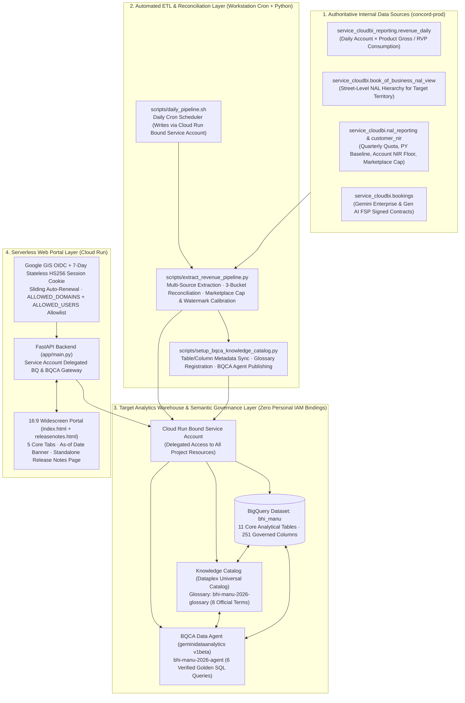
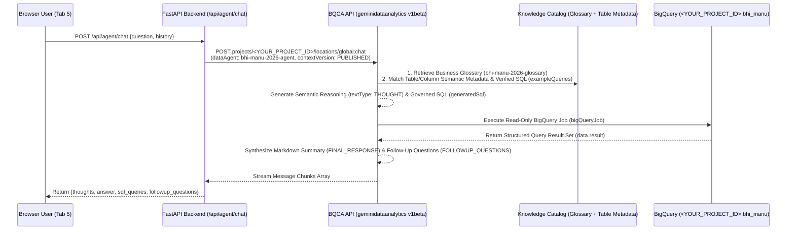
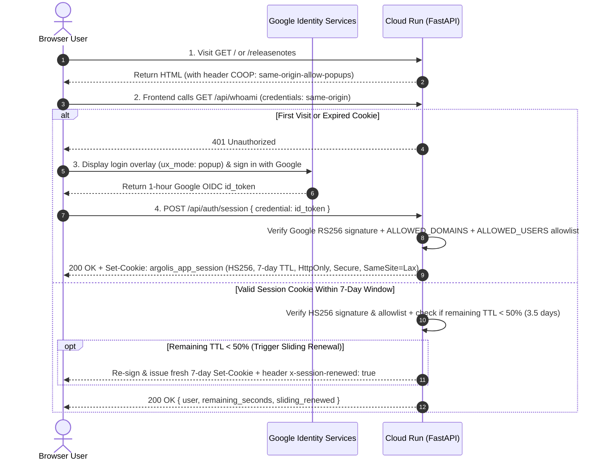

# Software Design Document (SDD v1.9): 2026 Industry Revenue, RunRate & Three-Bucket Quota Portal (with BQCA + Knowledge Catalog Semantic Engine & Stateless Long-Lived Session Auth)

- **Document Version**: `v1.9 (Production Release)`
- **Last Updated**: `2026-10-13`
- **Target Audience**: `Google Cloud Regional & Industry Verticals (BHI / Manufacturing / Retail / FSI / Auto / Gaming — Replicable Across Any Territory)`
- **Target GCP Project & Dataset**: `<YOUR_PROJECT_ID>.<YOUR_DATASET>` (e.g., `bhi_manu`)
- **BQCA Data Agent Resource**: `projects/<YOUR_PROJECT_ID>/locations/global/dataAgents/bhi-manu-2026-agent`
- **Knowledge Catalog Business Glossary**: `projects/<YOUR_PROJECT_ID>/locations/global/glossaries/bhi-manu-2026-glossary`
- **Language Editions**: [中文版 (SDD_cn.md)](./SDD_cn.md) | **English Edition (SDD_en.md)**

---

## 1. Executive Summary & Design Goals

### 1.1 Business Challenges
In daily operations across Google Cloud regional and industry verticals, sales leaders, Field Sales Representatives (FSRs), and Customer Engineers (CEs) face five recurring pain points:
1. **Fragmented Data Sources & Metrics**: Daily cloud consumption resides in `concord-prod.service_cloudbi_reporting.revenue_daily`, whereas Three-Bucket Quota targets, Prior-Year (PY) Baselines, Account-Level Negative Attainment Floors (NIR Floor), and Gemini Enterprise (GE) Bookings (`NETACV_MONTHLY`) are scattered across multiple views in `concord-prod.service_cloudbi`.
2. **Complex RVP vs. Gross Revenue & Cloud Marketplace Cap Rules**: Sales attainment is measured on **RVP Revenue** (net of commercial incentives/credits, where 3P Marketplace spend carries a `0.5x` / 50% multiplier). Furthermore, Bucket 1 (`GCP iRevenue`) enforces a **25% Marketplace Quota Cap**, while Bucket 2 (`DA, DB & Cloud AI iRevenue`) counts **1P native products only** (excluding 3P Marketplace AI subscriptions). Naive SQL queries against raw tables frequently diverge from `go/rainmaker`.
3. **Opaque Gemini Enterprise Watermark Reconciliation**: Gemini Enterprise is measured on Monthly Net Incremental ACV (`NETACV_MONTHLY`). Reconciling raw 100% signed contract value to the final `go/rainmaker` recognized attainment requires a three-step bridge: excluding renewals, applying the `10%` weight to `Gen AI FSP` contracts, and deducting historical monthly watermarks and de-bookings.
4. **Strict Privacy & Organizational Security Compliance**:
   - Querying individual compensation snapshots exposes sensitive PII/Compensation data; the architecture must operate on a **100% Territory- and Street-Level NAL (Named Account List) aggregated model** with zero personal compensation fields stored.
   - Under Argolis organizational security policies (**Domain Restricted Sharing**), cross-domain personal user accounts (`user:*@google.com`) cannot be granted direct IAM bindings on the target project; all backend resource access must be delegated through a dedicated Cloud Run Service Account.
   - Native Google Identity Services (GIS) OIDC `id_token`s have a hard-coded **1-hour (`3600s`)** expiration, causing users to be logged out every hour when viewing dashboards.
5. **Slow Turnaround on Long-Tail Ad-Hoc Queries**: Static dashboards cannot answer ad-hoc cross-table questions (e.g., *"Which accounts have high DA/DB/AI consumption but zero Gemini Enterprise bookings?"* or *"Which accounts experienced the sharpest Daily RunRate drop compared to last month's average?"*). Ungoverned LLMs writing raw SQL frequently hallucinate internal quota rules.

### 1.2 Core Design Objectives
- **100% Metric Alignment with `go/plan2100` & `go/rainmaker`**: Automatically reconcile Territory and Street-Level NAL performance across Bucket 1 (`GCP iRevenue`), Bucket 2 (`DA, DB & Cloud AI iRevenue`), and Bucket 3 (`Gemini Enterprise Net ACV`), incorporating Account-Level Zero-Floor rules, the 25% Marketplace Quota Cap, Bucket 2 1P-Only filtering, and an explicit As-of Date reconciliation banner.
- **Stateless 7-Day Session + Sliding Expiration Authentication**: Exchange the 1-hour Google OIDC `id_token` for an application-signed **7-day (`604800s`) stateless `HS256` `HttpOnly` Session Cookie** (`argolis_app_session`). Automatically renew the cookie when remaining TTL drops below 50% (3.5 days), enforce multi-domain (`google.com`, `*.altostrat.com`) and explicit user (`ALLOWED_USERS`) allowlists, and remain 100% compatible with Cloud Run Scale-to-Zero without Redis or external databases.
- **Two-Tier Aggregation & Interactive Daily RunRate (DRR) Drill-Down**: Provide both **NAL-level (Tier 1)** and **Account-level (Tier 2)** scorecards paired with interactive daily **DRR** time-series charts; clicking any row's first column smoothly scrolls to and updates the corresponding DRR curve.
- **Governed Long-Tail Analytics via BQCA + Knowledge Catalog**: Leverage native **BigQuery Conversational Analytics (`geminidataanalytics.googleapis.com/v1beta`)** and **Knowledge Catalog (`dataplex.googleapis.com/v1`)** to inject 11 tables / 251 column descriptions, 8 governed business glossary terms, and 6 verified golden SQL examples into a governed Data Agent for hallucination-free, auditable Text-to-SQL conversations.
- **Full Auditability (Release Notes) & 15-Minute Replicability**: Include a standalone Release Notes & Audit Changelog page (`/releasenotes`) and modular ETL/governance scripts so any global regional or vertical team can clone and deploy the entire stack in 15 minutes.

---

## 2. End-to-End System Architecture



---

## 3. Repository Structure

```text
manu-bhi/
├── SDD_cn.md                                # Software Design Document — Chinese Edition (v1.9)
├── SDD_en.md                                # Software Design Document — English Edition (v1.9)
├── skills/
│   ├── cloudrun-session-domain-auth/
│   │   └── SKILL.md                         # Reusable Skill Spec: Cloud Run 7-30 Day Stateless Session + Sliding Renewal Auth
│   └── cloudrun-session-domain-auth.zip     # Packaged Skill Archive (ready to unzip into ~/.gemini/config/skills/)
├── scripts/
│   ├── extract_revenue_pipeline.py          # Core ETL Pipeline: extracts from concord-prod and builds 11 analytical tables
│   ├── setup_bqca_knowledge_catalog.py      # Semantic Governance Script: syncs BQ table/column comments, Dataplex Glossary & BQCA Agent
│   └── daily_pipeline.sh                    # Daily automated refresh script triggered by crontab
├── app/
│   ├── Dockerfile                           # Cloud Run container image definition (Python 3.12-slim + uvicorn)
│   ├── requirements.txt                     # Backend Python dependencies (FastAPI, PyJWT, google-auth, BigQuery)
│   ├── main.py                              # FastAPI backend (7-day stateless session auth, sliding renewal, reporting APIs, BQCA gateway)
│   └── templates/
│       ├── index.html                       # 16:9 widescreen SPA dashboard (2-tier DRR curves, sticky headers/columns, multi-line BQCA chat)
│       └── releasenotes.html                # Standalone Release Notes & Audit Changelog page (v1.0.0 -> v1.9.0 with filtering & search)
└── logs/
    └── cron.log                             # Daily cron execution log
```

---

## 4. Core Business Definitions & Reconciliation Algorithms (`go/plan2100` & `go/rainmaker`)

### 4.1 Revenue & RunRate Fundamentals
| Term | Column Naming Convention | Business Definition & Formula |
| :--- | :--- | :--- |
| **RVP Revenue (Recognized Sales Revenue)** | `*_rvp_*` | Net revenue recognized for sales compensation (incorporating commercial incentive/credit multipliers). **Default metric displayed across the portal.** |
| **Gross Revenue (Raw Billed Consumption)** | `*_gross_*` | Unadjusted gross cloud consumption billed in the GCP Console (prior to incentive multipliers). |
| **Daily Run Rate (DRR)** | `*_drr` / `*_drr_7d_avg` | Single-day cloud consumption (`USD/day`). Defaults to the latest complete billing day (`T-2`), paired with a 7-day moving average to smooth weekend seasonality. |
| **Monthly Run Rate (MRR)** | `*_mrr` | Actual cumulative calendar-month consumption (e.g., prior full month or current MTD). **Never artificially extrapolated as `DRR × 30`.** |
| **Calendar Prorated Benchmark** | Dynamically computed in UI | `Elapsed Days YTD / 365`, used to benchmark whether YTD Quota Attainment % is ahead of or behind calendar pace. |

### 4.2 Product Line Classification Rules in `revenue_daily`
In `scripts/extract_revenue_pipeline.py`, product hierarchies follow `go/plan2100`:
1. **Total GCP (`is_gcp_plan2100`)**:
   - `fph_product_level_1 = 'Google Cloud Platform'` (covers Compute, Storage, Networking, Data Analytics, Databases, Cloud AI, Apigee, Cloud Marketplace, etc.).
2. **Cloud AI (`is_cloud_ai_plan2100`)**:
   - `fph_product_level_2 IN ('Vertex AI', 'Cloud AI')` OR `gtm_product_level_5 IN ('Build with AI', 'Customer Engagement', 'Developer AI Assistance')`.
3. **Data Analytics (`da_*`)**:
   - `fph_product_level_2 IN ('Data Analytics', 'Looker')` OR `gtm_product_level_5 IN ('Analytics', 'Looker')` (BigQuery, Dataflow, Dataproc, Pub/Sub, Looker, etc.).
4. **Databases (`db_*`)**:
   - `fph_product_level_2 = 'Databases'` OR `gtm_product_level_5 = 'Migrate and Modernize Databases'` (Spanner, AlloyDB, Cloud SQL, Bigtable, Memorystore, Firestore, etc.).

### 4.3 Three Quota Buckets & Cloud Marketplace Cap Reconciliation Algorithms
1. **Bucket 1: GCP iRevenue (Incremental Revenue)**
   - **Product Scope (`service_cloudbi.nal_reporting`)**: `product IN ('GCP_CLASSIC_FIELD', 'INFRA_AI', 'AI_SOLUTIONS', 'DEVELOPER_AI_ASSISTANCE', 'APIGEE')`.
   - **Core Formula**:
     $$\text{Incremental Quota} = \text{Gross Quota} - \text{PY Baseline}$$
     $$\text{Attainment \%} = \frac{\text{YTD Incremental Actuals}}{\text{Incremental Quota}} \times 100\%$$
   - **Account-Level Negative Attainment Zero-Floor (`ApplyAccountNegativeAttainmentToNetZeroRule`)**: Aggregated per customer from `service_cloudbi.customer_nir` (`b1_nir`). If a customer contracts YoY (`b1_nir < 0`), its contribution is floored at zero via `GREATEST(b1_nir, 0)` so shrinking accounts do not claw back positive growth from other accounts in the same NAL.
   - **Cloud Marketplace Three-Tier Compensation Rules (`go/plan2100`)**:
     1. **50% RVP Multiplier (`0.5x`)**: Third-party (3P) SaaS or model subscriptions procured via Cloud Marketplace are recognized in `rvp_revenue` at **50%** of Gross billed spend;
     2. **Bucket 1 25% Marketplace Quota Cap**: Across any single NAL, total net incremental revenue contributed by 3P Marketplace (`Marketplace NIR`) toward Bucket 1 attainment is capped at **25% of that NAL's annual Bucket 1 Incremental Quota**:
        $$\text{Recognized Marketplace NIR} = \min\left(\text{Raw Marketplace NIR},\; 0.25 \times \text{Bucket 1 Incremental Quota}\right)$$
     3. **Single-Account iRevenue Cap**: Under the Core FSR/CE Plan, a single account's net incremental revenue contribution is capped at `200%` of the component annual incremental quota with a minimum floor cap of `$2.5M` ($\max(2.0 \times \text{Quota}, \$2.5\text{M})$). Under the Select / Enterprise Plan, there is no 200% single-account cap, though the 25% Marketplace Quota Cap strictly applies.
2. **Bucket 2: DA, DB & Cloud AI iRevenue (Data & AI Incremental Revenue)**
   - **Product Scope (`service_cloudbi.nal_reporting`)**: `product IN ('ANALYTICS', 'LOOKER', 'MIGRATE_AND_MODERNIZE_DATABASES', 'AI_SOLUTIONS', 'DEVELOPER_AI_ASSISTANCE')`.
   - **1P Native Product Eligibility Rule (Excludes 3P Marketplace)**: Even though certain 3P Marketplace model subscriptions may carry the tag `gtm_product_level_5 = 'Build with AI'` in `customer_nir`, `go/plan2100` restricts Bucket 2 attainment strictly to **Google 1P native Data & AI products** (`fph_product_level_2 IN ('Vertex AI', 'Cloud AI', 'Data Analytics', 'Looker', 'Databases')`). All `fph_product_level_2 = 'Cloud Marketplace'` spend is excluded from Bucket 2.
3. **Bucket 3: Gemini Enterprise Net ACV (Monthly Net Incremental Bookings ACV)**
   - **Data Sources**: `concord-prod.service_cloudbi.bookings` (**no T-2 lag filter**, synced in real time) and `nal_reporting` (`product = 'AGENTSPACE'`).
   - **Three-Step Reconciliation Bridge**:
     - **Step 1 (Raw 100% Signed ACV `signed_acv`)**: Sum of raw contract ACV where `product_l3 IN ('Gemini Enterprise', 'Gen AI FSP')`;
     - **Step 2 (Pre-Watermark Net iACV `pre_watermark_net_iacv`)**:
       - Exclude renewal ACV (`comp_renewal_acv`);
       - Apply the `go/plan2100` **10% weight** to `product_l3 = 'Gen AI FSP'` (deducting 90% of raw FSP ACV):
         $$\text{Pre-Watermark Net iACV} = \text{New/Expansion GE ACV} \times 100\% + \text{New/Expansion FSP ACV} \times 10\%$$
     - **Step 3 (Monthly Watermark & De-booking Adjustment `watermark_adjustment`)**:
       - Align with `service_cloudbi.nal_reporting` (`product = 'AGENTSPACE'`, `quota_metric_Basis = 'NETACV_MONTHLY'`), deducting historical monthly watermarks and de-bookings to match `go/rainmaker` final attainment (`rainmaker_final_attainment`) 100%.

---

## 5. Target Data Warehouse Schema (`<YOUR_PROJECT_ID>.bhi_manu` — 11 Tables)

| # | Table ID | Grain | Primary Purpose & Corresponding UI View |
| :---: | :--- | :--- | :--- |
| 1 | `customer_revenue_scorecard_2026` | `reporting_id` (Account) | Account-level YTD RVP/Gross revenue (GCP/AI/DA/DB/GE), latest single-day DRR, 7d avg, current/prior month MRR (Tab 1 & Tab 2 Tier-2 table) |
| 2 | `nal_revenue_scorecard_2026` | `nal_name` (NAL) | NAL-level YTD RVP/Gross revenue, latest single-day DRR, current/prior month MRR & AI penetration rate (Tab 1 & Tab 2 Tier-1 table) |
| 3 | `customer_monthly_revenue` | `reporting_id × year_month` | Account × monthly cumulative RunRate (MRR) and monthly average DRR (Monthly trend charts & MoM analysis) |
| 4 | `customer_daily_runrate` | `reporting_id × usage_date` | YTD daily RunRate (DRR through `T-2`), MTD cumulative & 7-day moving average (powers both NAL-level and Account-level daily DRR curves) |
| 5 | `customer_ge_bookings_2026` | `reporting_id × sku_description` | Gemini Enterprise & Gen AI FSP customer contracts, seats, TCV, 100% Signed ACV & weighted Net iACV (Tab 3 Tier-2 table) |
| 6 | `nal_ge_bookings_2026` | `nal_name` (NAL) | NAL-level summary of GE booked accounts, seats, raw signed ACV, pre-watermark Net iACV & Rainmaker final attainment (Tab 3 Tier-1 table) |
| 7 | `ge_monthly_bookings_2026` | `year_month` (Month) | Monthly GE New, Expansion, Renewal & Net Incremental bookings trend (Tab 3 monthly bar chart) |
| 8 | `nal_three_buckets_quota_2026` | `nal_id` (Street NAL) | **Core Quota Reconciliation Table**: PY Baseline, Gross/Incremental Quota, YTD Actuals & Attainment % across all 3 buckets (Top Banner & Tab 4) |
| 9 | `territory_quarterly_quota_2026` | `quarter × product` | Q1–Q4 quarterly breakdown of PY Baseline, Quota & Actuals by compensation product line (Tab 4 Section 3) |
| 10 | `customer_product_revenue_daily` | `reporting_id × usage_date × fph_l3` | Fine-grained daily account × product consumption for deep drill-down queries |
| 11 | `customer_ge_details_2026` | `reporting_id × fph_l5` | Billing-side GE sub-product consumption details |

---

## 6. BQCA + Knowledge Catalog Semantic Governance Architecture

Instead of stuffing raw table schemas into an LLM prompt, this system implements a three-layer semantic governance architecture using native **BQCA (`geminidataanalytics.googleapis.com/v1beta`) + Knowledge Catalog (`dataplex.googleapis.com/v1`)** (see `scripts/setup_bqca_knowledge_catalog.py`):



### 6.1 Layer 1: Automated BigQuery Table & Column Semantic Metadata Sync
- `update_bigquery_knowledge_catalog_metadata()` iterates across all 11 tables in `bhi_manu` and invokes `bq_client.update_table(table, ["description", "labels", "schema"])` to persist table descriptions and bilingual definitions for all **251 columns**.
- BigQuery automatically synchronizes these annotations into **Dataplex Universal Catalog (Knowledge Catalog)** `@bigquery` entries. The metadata sync runs automatically after each daily `WRITE_TRUNCATE` ETL job so column descriptions are never lost.

### 6.2 Layer 2: Governed Knowledge Catalog Business Glossary (`bhi-manu-2026-glossary`)
- Registered via the Dataplex API (`https://dataplex.googleapis.com/v1/projects/<YOUR_PROJECT_ID>/locations/global/glossaries/bhi-manu-2026-glossary`) with 8 official compensation and revenue terms:
  - `rvp-revenue` (`RVP Revenue`)
  - `gross-revenue` (`Gross Revenue`)
  - `bucket-1-gcp-irevenue` (`Bucket 1: GCP iRevenue`)
  - `bucket-2-dadbai-irevenue` (`Bucket 2: DA, DB & Cloud AI iRevenue`)
  - `bucket-3-ge-net-acv` (`Bucket 3: Gemini Enterprise Net ACV`)
  - `ge-watermark-reconciliation` (`GE Watermark Reconciliation Bridge`)
  - `daily-run-rate-drr` (`Daily Run Rate (DRR)`)
  - `monthly-run-rate-mrr` (`Monthly Run Rate (MRR)`)

### 6.3 Layer 3: BQCA Data Agent (`bhi-manu-2026-agent`) Published Context
- Published via `https://geminidataanalytics.googleapis.com/v1beta/projects/<YOUR_PROJECT_ID>/locations/global/dataAgents/bhi-manu-2026-agent` with:
  - `datasourceReferences.bq.tableReferences`: binds core analytical tables along with `schema.fields`, `synonyms`, and `tags`;
  - `glossaryTerms`: embeds the 8 governed business terms;
  - `exampleQueries`: 6 human-verified golden SQL question-query pairs (Verified Queries);
  - `systemInstruction`: enforces structured Markdown output, default RVP revenue rules, and Three-Bucket reconciliation logic.

---

## 7. Stateless 7-Day Session Authentication, Backend APIs & Frontend UX

### 7.1 Stateless Long-Lived Session (7-Day TTL) + Sliding Auto-Renewal (`cloudrun-session-domain-auth`)
To eliminate hourly re-logins caused by Google Identity Services (GIS) OIDC `id_token`s expiring after 1 hour (`3600s`)—without deploying an External Application Load Balancer (ALB) or Redis—`app/main.py` implements stateless session management (packaged in [`skills/cloudrun-session-domain-auth/SKILL.md`](./skills/cloudrun-session-domain-auth/SKILL.md)):



- **Key Engineering Safeguards**:
  1. **Custom Semicolon Cookie Parser (`extract_cookie_token`)**: The Google GIS SDK writes a `g_state={"i_l":0}` cookie containing curly braces and double quotes on the same origin. Python's standard `http.cookies.SimpleCookie` (used by `request.cookies`) aborts parsing when encountering `g_state={"i_l":0}`, dropping any subsequent cookies. Our backend splits the raw `Cookie` header by `;` to reliably extract `argolis_app_session`.
  2. **COOP Header & Popup Mode**: HTML routes explicitly return `cross-origin-opener-policy: same-origin-allow-popups`, and the frontend GIS button initializes with `ux_mode: 'popup'` inside a `setTimeout(..., 80)` callback so browser popup `postMessage` events are never blocked.
  3. **Scale-to-Zero & Multi-Instance Statelessness**: All session claims (`sub`, `email`, `name`, `iat`, `exp`, `type`) are signed with `HMAC-SHA256` using the `SESSION_SECRET` environment variable and stored in the client's `HttpOnly` cookie, surviving container cold starts and horizontal scaling.

### 7.2 Backend API Contract (`app/main.py`)
All `/api/*` endpoints are protected by `Depends(require_session)` (validating the `HttpOnly` session cookie, gateway header, or Bearer token against `ALLOWED_DOMAINS` and `ALLOWED_USERS`):

| HTTP Method & Path | Description | Underlying Tables / Services |
| :--- | :--- | :--- |
| `GET /` | Serves the main dashboard HTML page (`COOP: same-origin-allow-popups`) | `app/templates/index.html` |
| `GET /releasenotes` | Serves the standalone Release Notes & Changelog HTML page (`v1.0.0` → `v1.9.0`) | `app/templates/releasenotes.html` |
| `GET /authconfig` | Returns `client_id`, `allowed_domains`, and `session_ttl_seconds` for GIS | Environment Configuration |
| `POST /api/auth/session` | Verifies the 1-hour Google `id_token` and issues a 7-day `HttpOnly` Session Cookie | `google.oauth2.id_token` + `PyJWT` |
| `GET /api/whoami` | Validates current session status (triggers sliding auto-renewal if remaining TTL `< 50%`) | `require_session` |
| `POST /api/auth/logout` | Clears the `argolis_app_session` cookie and logs out | Cookie Destruction |
| `GET /api/dashboard-data` | Returns Territory Three-Bucket summaries, KPI cards, NAL scorecards, monthly trends & account details | `bhi_manu` Analytical Tables |
| `GET /api/nal-trend?nal_name=...` | Returns 2026 daily DRR time series for a specific NAL or `ALL` (GCP/AI/DA/DB in both RVP & Gross) | `customer_daily_runrate` |
| `GET /api/customer-trend?reporting_id=...` | Returns 2026 daily DRR time series and 7-day moving average for a specific customer | `customer_daily_runrate` |
| `GET /api/agent/catalog` | Returns metadata for the bound BQCA Data Agent and Knowledge Catalog glossary | `geminidataanalytics` & `dataplex` |
| `POST /api/agent/chat` | Invokes BQCA `:chat`, returning semantic reasoning (`thoughts`), Markdown answer (`answer`), executed SQL (`sql_queries`), and follow-ups (`followup_questions`) | `geminidataanalytics.googleapis.com/v1beta` |

### 7.3 Frontend 16:9 Widescreen & UX Highlights (`app/templates/index.html` & `releasenotes.html`)
1. **16:9 Widescreen Responsive Layout**: Uses `max-width: 98vw` to display multi-bucket, multi-metric scorecards without horizontal cramping.
2. **Bi-Directional Sticky Table Headers & First Columns**:
   - Table headers (`thead th`) stick to the top (`position: sticky; top: 0; z-index: 20`);
   - The first column (NAL Name or Account Name) sticks to the left (`position: sticky; left: 0; z-index: 10`, top-left corner `z-index: 30`) for effortless vertical and horizontal scrolling.
3. **Click-First-Column DRR Drill-Down (Two-Tier NAL & Account Curves)**:
   - Clicking any row's **first column (NAL Name or Account Name)** smoothly scrolls to and loads the corresponding **NAL-level DRR chart** or **Account-level DRR chart**.
4. **Quota Attainment As-of Date Reconciliation Banner**:
   - Tab 4 displays a prominent reconciliation cutoff banner distinguishing consumption metrics (`T-2` latest complete billing date for Buckets 1 & 2) from real-time contract bookings (Bucket 3 GE Net ACV) for side-by-side verification with `go/rainmaker`.
5. **Multi-Line BQCA Chat Editor**:
   - The `#agentInput` `<textarea rows="3">` inserts a newline on `Enter` so users can compose structured multi-line queries, while `Ctrl/Cmd + Enter` or clicking **Send Query 🚀** submits the request.
6. **Standalone Release Notes Page (`/releasenotes`)**:
   - Accessible from the top navigation bar (**📋 Release Notes** button next to the **🔒 7-Day Session** badge), documenting all 10 releases (`v1.0.0` through `v1.9.0`) with category filter chips and live keyword search.

---

## 8. Step-by-Step Reproduction Guide (15-Minute Clone for Any Territory)

Global regional or industry teams (e.g., Retail, FSI, Auto, Gaming) can replicate this system in **5 steps**:

### Step 1: Enable Required GCP APIs & Configure Service Account IAM (Argolis Policy Compliant)
> **Security Compliance Rule (Domain Restricted Sharing)**: Under Argolis organization policies, **never grant IAM bindings or BigQuery ACLs directly to cross-domain personal accounts (`user:*@google.com`)**. Grant all BigQuery, Dataplex Knowledge Catalog, and BQCA permissions exclusively to the dedicated Cloud Run Service Account `<YOUR_SA_NAME>@<YOUR_PROJECT_ID>.iam.gserviceaccount.com`.

```bash
export PROJECT_ID="<YOUR_PROJECT_ID>"  # Replace with your target GCP Project ID
export SA_EMAIL="<YOUR_SA_NAME>@${PROJECT_ID}.iam.gserviceaccount.com"  # Dedicated Cloud Run Service Account

# 1. Enable BigQuery, Cloud Run, Cloud Build, BQCA, and Dataplex Knowledge Catalog APIs
gcloud services enable \
  bigquery.googleapis.com \
  run.googleapis.com \
  cloudbuild.googleapis.com \
  geminidataanalytics.googleapis.com \
  dataplex.googleapis.com \
  datacatalog.googleapis.com \
  cloudaicompanion.googleapis.com \
  --project="${PROJECT_ID}"

# 2. Grant BigQuery, Knowledge Catalog, and BQCA roles exclusively to the Service Account
for role in \
  roles/bigquery.admin \
  roles/geminidataanalytics.admin \
  roles/geminidataanalytics.dataAgentCreator \
  roles/geminidataanalytics.dataAgentOwner \
  roles/geminidataanalytics.dataAgentUser \
  roles/geminidataanalytics.dataAgentStatelessUser \
  roles/geminidataanalytics.queryDataUser \
  roles/dataplex.admin \
  roles/dataplex.catalogAdmin \
  roles/dataplex.taxonomyAdmin \
  roles/cloudaicompanion.user \
  roles/serviceusage.serviceUsageConsumer; do
  gcloud projects add-iam-policy-binding "${PROJECT_ID}" \
    --member="serviceAccount:${SA_EMAIL}" \
    --role="${role}" --condition=None --quiet
done
```

### Step 2: Set Up Python Virtual Environment & Run Initial ETL Pipeline
On an internal workstation (e.g., Cloudtop) with read access to `concord-prod` (source tables are queried using personal ADC, while target tables in `<YOUR_PROJECT_ID>.bhi_manu` are written via the Service Account credentials):

```bash
cd /path/to/manu-bhi
python3 -m venv .venv
.venv/bin/pip install google-cloud-bigquery pandas pyarrow db-dtypes requests google-auth PyJWT

# Update target project, dataset, and territory NAL filter in scripts/extract_revenue_pipeline.py, then run:
.venv/bin/python scripts/extract_revenue_pipeline.py
```

### Step 3: Initialize Knowledge Catalog Glossary & BQCA Data Agent
Run the semantic governance script to populate all 11 tables / 251 column descriptions, create the Dataplex Business Glossary, publish the BQCA Data Agent, and execute an end-to-end `:chat` smoke test:

```bash
.venv/bin/python scripts/setup_bqca_knowledge_catalog.py
```

### Step 4: Build & Deploy to Cloud Run (With 7-Day Stateless Session Secret & User Allowlist)
Deploy from the `app/` directory with `--service-account="${SA_EMAIL}"`, `SESSION_SECRET`, `SESSION_TTL_SECONDS=604800`, `ALLOWED_DOMAINS`, and `ALLOWED_USERS`:

```bash
export SESSION_SECRET="$(python3 -c 'import secrets; print(secrets.token_hex(32))')"
export OAUTH_CLIENT_ID="<YOUR_OAUTH_WEB_CLIENT_ID>.apps.googleusercontent.com"

gcloud run deploy bhi-manu-revenue-portal \
  --source app \
  --region us-central1 \
  --project "${PROJECT_ID}" \
  --service-account "${SA_EMAIL}" \
  --allow-unauthenticated \
  --set-env-vars="^|^APP_AUTH=1|GOOGLE_CLOUD_PROJECT=${PROJECT_ID}|BQ_DATASET=bhi_manu|BQCA_AGENT_ID=bhi-manu-2026-agent|OAUTH_CLIENT_ID=${OAUTH_CLIENT_ID}|SESSION_SECRET=${SESSION_SECRET}|SESSION_TTL_SECONDS=604800|ALLOWED_DOMAINS=google.com,*.altostrat.com|ALLOWED_USERS=user1@google.com,user2@google.com" \
  --quiet
```

### Step 5: Configure Automated Daily Crontab Refresh
Configure `crontab -e` to automatically sync the latest `concord-prod` data and refresh Knowledge Catalog metadata every day:

```cron
0 19 * * * /path/to/manu-bhi/scripts/daily_pipeline.sh >> /path/to/manu-bhi/logs/cron.log 2>&1
```

---

## 9. Post-Deployment Verification Checklist

After deployment, verify data accuracy, stateless session longevity, IAM compliance, and UI interactivity across these 6 checks:
1. **Three-Bucket Quota & Attainment Reconciliation**:
   - **Bucket 1 (`GCP iRevenue`) & Bucket 2 (`DA, DB & Cloud AI iRevenue`)**: Verify that `Incremental Quota` and `YTD Actuals` in the Top Banner and Tab 4 match `go/rainmaker` 100% (confirming Account-Level Zero-Floor `GREATEST(nir, 0)`, Bucket 1's 25% Marketplace Quota Cap, and Bucket 2's 1P-Only filter).
   - **Bucket 3 (`Gemini Enterprise Net ACV`)**: Verify the Three-Step Reconciliation Bridge in Tab 3 (`100% Raw Signed ACV` → `Pre-Watermark Net iACV after Renewal Exclusion & 10% FSP Weight` → `Final Rainmaker Attainment after Monthly Watermark Deduction`).
2. **7-Day Stateless Session & Sliding Auto-Renewal Verification**:
   - Confirm `/` and `/releasenotes` return `cross-origin-opener-policy: same-origin-allow-popups`;
   - Confirm login issues `argolis_app_session` (`HttpOnly; Secure; SameSite=Lax; Max-Age=604800`), remains valid past the 1-hour GIS `id_token` expiry, and returns `x-session-renewed: true` with a refreshed 7-day cookie when remaining TTL `< 50%`.
3. **Argolis IAM Compliance Check**:
   - Run `gcloud projects get-iam-policy <YOUR_PROJECT_ID>` and confirm zero cross-domain personal user (`user:*@google.com`) bindings exist.
4. **Two-Tier Table & DRR Curve Drill-Down**: Click any NAL name or Account name in the first column and confirm the corresponding NAL or Account daily DRR curve updates smoothly.
5. **Standalone Release Notes Page (`/releasenotes`)**: Click **📋 Release Notes** in the top bar and test category filtering and keyword search.
6. **BQCA + Knowledge Catalog Conversational Analytics**: Test multi-line input (`Enter` for newline) and query submission in Tab 5, verifying expandable **🧠 Semantic Reasoning Chain**, **🗄️ Generated BigQuery SQL (with Job ID & CSV Export)**, and **💡 Suggested Follow-Up Questions**.
