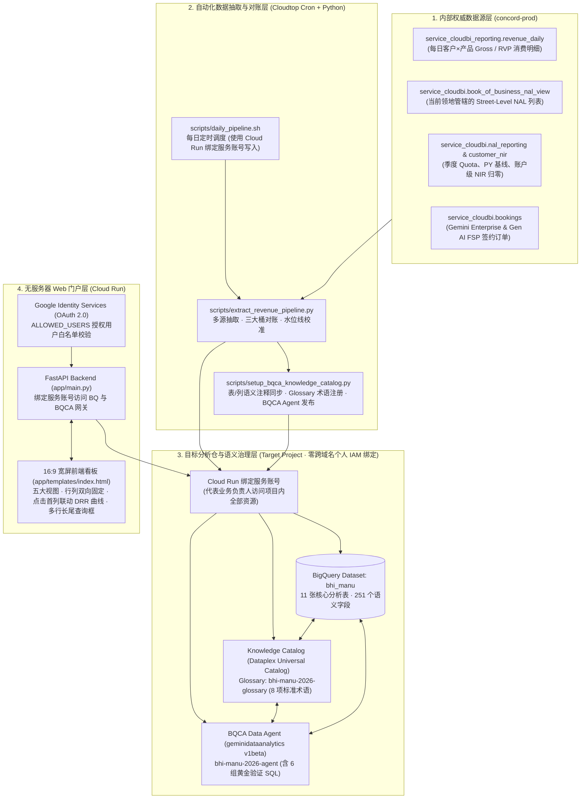
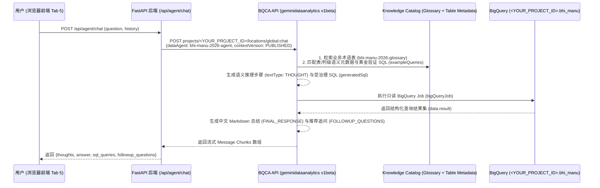

# 软件设计说明书 (SDD v1.0)：2026 行业线收入、RunRate 与三大桶 Quota 达成门户（含 BQCA + Knowledge Catalog 智能分析引擎）

- **文档版本**：`v1.0 (Production Release)`
- **发布日期**：`2026-10-12`
- **适用范围**：`Google Cloud 区域与行业线 (BHI / Manufacturing 等领地可通用复用)`
- **目标 GCP 项目与数据集**：`<YOUR_PROJECT_ID>.<YOUR_DATASET>`（示例：`bhi_manu`）
- **BQCA Data Agent 资源**：`projects/<YOUR_PROJECT_ID>/locations/global/dataAgents/bhi-manu-2026-agent`
- **Knowledge Catalog 术语表**：`projects/<YOUR_PROJECT_ID>/locations/global/glossaries/bhi-manu-2026-glossary`

---

## 1. 系统背景与设计目标 (Executive Summary)

### 1.1 业务痛点
在 Google Cloud 区域与行业线的日常经营分析中，销售负责人与 Customer Engineer (CE) 面临以下核心痛点：
1. **多源口径割裂**：日常消费出账数据位于 `concord-prod.service_cloudbi_reporting.revenue_daily`，而三大考核桶 Quota、去年同期基线（PY Baseline）、账户级负向归零（NIR Floor）以及 Gemini Enterprise (GE) 合同签约（Bookings Net ACV）分散在 `concord-prod.service_cloudbi` 的多张视图中。
2. **RVP 认账与 Gross 毛消费混淆**：销售考核以含激励折算的 **RVP Revenue** 为准，而技术侧容量规划常看 **Gross Revenue**，混在同一张表中极易误读。
3. **GE 签约水位线（Monthly Watermark）对账困难**：Gemini Enterprise 采用签约净增年化合同额（`NETACV_MONTHLY`）考核，从客户 100% 原始签约额到 `go/rainmaker` 最终认账达成之间涉及续约剔除、`Gen AI FSP` 10% 权重折算以及历史最高水位线冲减三步核算。
4. **隐私合规要求**：直接查询个人级薪酬快照表会涉及个人敏感薪酬信息（PII / Compensation），需要构建一套**100% 领地级（Territory）与街区级（Street-Level NAL）脱敏汇总架构**，不存储任何个人薪酬字段。
5. **长尾查询响应慢**：固定报表难以覆盖临时的跨表组合查询（如“高 DA/DB/AI 消费但未签 GE 的空白商机客户”、“近期单日 RunRate 相比上月日均跌幅最大的预警客户”），传统 LLM 裸写 SQL 容易搞错内部考核口径。

### 1.2 核心设计目标
- **口径 100% 对齐 `go/plan2100` 与 `go/rainmaker`**：自动完成 Bucket 1 (`GCP iRevenue`)、Bucket 2 (`DA, DB & Cloud AI iRevenue`)、Bucket 3 (`Gemini Enterprise Net ACV`) 的领地级与各 Street-Level NAL 级精确对账。
- **双层汇总与双层级每日 RunRate 曲线下钻**：同时提供 **NAL 级（第一层，业务组汇总）** 与 **Account 级（第二层，客户明细）** 的汇总表及每日 **单日 RunRate (DRR)** 走势曲线，点击表格第一列即可联动切换曲线。
- **BQCA + Knowledge Catalog 语义治理长尾分析**：基于 Google Cloud 原生 **BigQuery Conversational Analytics (`geminidataanalytics.googleapis.com/v1beta`)** 与 **Knowledge Catalog (`dataplex.googleapis.com/v1`)**，将 11 张表 / 251 列语义描述、8 项官方业务术语及 6 组黄金验证 SQL 注入受治理的 Data Agent，实现零幻觉、可溯源的 Text-to-SQL 对话分析。
- **一键复制重现（Replicable by Design）**：其他行业线或区域团队仅需修改项目配置与领地 NAL 范围，即可在 15 分钟内完整克隆部署。

---

## 2. 端到端系统架构 (System Architecture)



---

## 3. 代码仓库目录结构 (Repository Structure)

```text
manu-bhi/
├── SDD_v1.0.md                              # 本软件设计说明书 (v1.0)
├── scripts/
│   ├── extract_revenue_pipeline.py          # 核心 ETL 管线：从 concord-prod 抽取并构建 11 张分析表（通过服务账号写入）
│   ├── setup_bqca_knowledge_catalog.py      # 语义治理脚本：通过服务账号同步 Knowledge Catalog 表/列注释、Glossary 与 BQCA Agent
│   └── daily_pipeline.sh                    # 每日定时刷新脚本（由 crontab 每日自动触发 ETL + 语义同步）
├── app/
│   ├── Dockerfile                           # Cloud Run 容器镜像构建文件 (Python 3.12-slim + uvicorn)
│   ├── requirements.txt                     # Web 后端 Python 依赖清单
│   ├── main.py                              # FastAPI 后端服务（含 ALLOWED_USERS 白名单鉴权、服务账号委托授权、报表 API、BQCA 网关）
│   └── templates/
│       └── index.html                       # 16:9 宽屏单页应用前端（双层 DRR 曲线 + 双向固定表格 + 多行回车换行 BQCA 对话框）
└── logs/
    └── cron.log                             # 每日定时任务执行日志
```

---

## 4. 核心业务口径与对账算法规范 (`go/plan2100` & `go/rainmaker`)

### 4.1 收入与 RunRate 基础定义
| 术语名称 | 字段命名规范 | 业务定义与计算公式 |
| :--- | :--- | :--- |
| **RVP Revenue (销售认账收入)** | `*_rvp_*` | 计入销售业绩考核（含商务激励 Incentives / Credits 折算系数）的净认账收入。**系统默认展示口径**。 |
| **Gross Revenue (毛消费出账收入)** | `*_gross_*` | 客户在 GCP 控制台实际产生的原始账单毛消费额（未乘以激励折算系数）。 |
| **Daily Run Rate (DRR, 单日 RunRate)** | `*_drr` / `*_drr_7d_avg` | 客户或 NAL 在单个自然日产生的云消费金额（USD/day）。默认取最新完整出账日（`T-2`）单日值，并提供近 7 日移动均值平滑周末波动。 |
| **Monthly Run Rate (MRR, 自然月累计 RunRate)** | `*_mrr` | 按自然月日历（如完整上月或当月 MTD）实际消费汇总的自然月累计 RunRate（**严禁做单日 ×30 的人工外推**）。 |
| **日历时间进度基准 (Calendar Prorated Benchmark)** | 前端动态计算 | `年初至今已过天数 / 全年总天数 (365)`，用于衡量年度 Quota 达成率是否超前于日历时间进度。 |

### 4.2 四大核心产品线在 `revenue_daily` 中的分类规则
在 `scripts/extract_revenue_pipeline.py` 中，基于 `go/plan2100` 产品层级映射如下：
1. **GCP 总盘 (`is_gcp_plan2100`)**：
   - `fph_product_level_1 = 'Google Cloud Platform'`（涵盖 Compute、Storage、Networking、Data Analytics、Databases、Cloud AI、Apigee 等全部计入 GCP 考核的产品）。
2. **Cloud AI (`is_cloud_ai_plan2100`)**：
   - `fph_product_level_2 IN ('Vertex AI', 'Cloud AI')` 或 `gtm_product_level_5 IN ('Build with AI', 'Customer Engagement', 'Developer AI Assistance')`。
3. **DA 数据分析 (`da_*`)**：
   - `fph_product_level_2 IN ('Data Analytics', 'Looker')` 或 `gtm_product_level_5 IN ('Analytics', 'Looker')`（对应 BigQuery、Dataflow、Dataproc、Pub/Sub、Looker 等）。
4. **DB 数据库 (`db_*`)**：
   - `fph_product_level_2 = 'Databases'` 或 `gtm_product_level_5 = 'Migrate and Modernize Databases'`（对应 Spanner、AlloyDB、Cloud SQL、Bigtable、Memorystore、Firestore 等）。

### 4.3 三大考核桶 (Three Quota Buckets) 对账算法
1. **Bucket 1: GCP iRevenue (增量收入)**
   - **产品范围 (`service_cloudbi.nal_reporting`)**：`product IN ('GCP_CLASSIC_FIELD', 'INFRA_AI', 'AI_SOLUTIONS', 'DEVELOPER_AI_ASSISTANCE', 'APIGEE')`。
   - **核心计算公式**：
     $$\text{Incremental Quota} = \text{Gross Quota} - \text{PY Baseline}$$
     $$\text{Attainment \%} = \frac{\text{YTD Incremental Actuals}}{\text{Incremental Quota}} \times 100\%$$
   - **账户级负向归零规则 (`ApplyAccountNegativeAttainmentToNetZeroRule`)**：从 `service_cloudbi.customer_nir` 按单客户汇总年度净增 `b1_nir`，若单客户同比萎缩（`b1_nir < 0`），按 `GREATEST(b1_nir, 0)` 归零，不倒扣同 NAL 下其他正向增长客户的业绩。
2. **Bucket 2: DA, DB & Cloud AI iRevenue (数据与 AI 增量收入)**
   - **产品范围 (`service_cloudbi.nal_reporting`)**：`product IN ('ANALYTICS', 'LOOKER', 'MIGRATE_AND_MODERNIZE_DATABASES', 'AI_SOLUTIONS', 'DEVELOPER_AI_ASSISTANCE')`。
   - **核心计算公式**：汇总上述 5 个考核子产品线的去年同期基线、2026 增量 Quota 与经账户级负向归零校准后的 YTD 增量达成实绩。
3. **Bucket 3: Gemini Enterprise Net ACV (签约净增年化合同额)**
   - **数据源**：`concord-prod.service_cloudbi.bookings`（**不加 T-2 延迟过滤**，实时同步截至当日的最新已签合同）与 `nal_reporting` (`product = 'AGENTSPACE'`)。
   - **三步对账桥梁（Three-Step Reconciliation Bridge）**：
     - **Step 1（原始 100% 签约年化总额 `signed_acv`）**：汇总 `product_l3 IN ('Gemini Enterprise', 'Gen AI FSP')` 的客户合同原始 ACV；
     - **Step 2（剔除续约 & FSP 10% 折算后 `pre_watermark_net_iacv`）**：
       - 剔除续约合同 `comp_renewal_acv`（续约不计入净增 Net ACV）；
       - `product_l3 = 'Gen AI FSP'` 按 `go/plan2100` 规则以 **10% 权重**折算（即核减 90% 的 FSP 原始签约额）：
         $$\text{Pre-Watermark Net iACV} = \text{New/Expansion GE ACV} \times 100\% + \text{New/Expansion FSP ACV} \times 10\%$$
     - **Step 3（扣除 `NETACV_MONTHLY` 月度历史水位线与退订冲减 `watermark_adjustment`）**：
       - 对齐 `service_cloudbi.nal_reporting` (`product = 'AGENTSPACE'`, `quota_metric_Basis = 'NETACV_MONTHLY'`)，扣除月度历史最高水位线（Monthly Watermark）与退订冲减额，得到与 `go/rainmaker` 100% 一致的最终认账达成（`rainmaker_final_attainment`）。

---

## 5. 目标数据仓模型设计 (`<YOUR_PROJECT_ID>.bhi_manu` 11 张表)

| 序号 | 表名 (Table ID) | 粒度 (Grain) | 核心用途与对应前端视图 |
| :---: | :--- | :--- | :--- |
| 1 | `customer_revenue_scorecard_2026` | `reporting_id` (客户级) | 客户级 YTD RVP/Gross 收入（GCP/AI/DA/DB/GE）、最新单日 DRR、7 日均值、当月/上月 MRR（Tab 1 & Tab 2 第二层表） |
| 2 | `nal_revenue_scorecard_2026` | `nal_name` (NAL 级) | NAL 级 YTD RVP/Gross 收入、最新单日 DRR、当月/上月 MRR 及 AI 渗透率（Tab 1 & Tab 2 第一层表） |
| 3 | `customer_monthly_revenue` | `reporting_id × year_month` | 客户×月度累计 RunRate (MRR) 与当月日均 DRR（月度趋势图 & MoM 分析） |
| 4 | `customer_daily_runrate` | `reporting_id × usage_date` | 年初至今（截至 T-2）每日单日 RunRate (DRR)、MTD 累计与 7 日移动平均（支持 NAL 级与客户级双层每日曲线） |
| 5 | `customer_ge_bookings_2026` | `reporting_id × sku_description` | Gemini Enterprise & Gen AI FSP 客户签约订单、席位数、TCV、100% Signed ACV 与折算后 Net iACV（Tab 3 第二层表） |
| 6 | `nal_ge_bookings_2026` | `nal_name` (NAL 级) | 按 NAL 汇总 GE 签约客户数、席位数、原始签约额、水位线前 Net iACV 与 Rainmaker 最终认账额（Tab 3 第一层表） |
| 7 | `ge_monthly_bookings_2026` | `year_month` (月度级) | 按月汇总 GE 新签 (New)、扩容 (Expansion)、续约 (Renewal) 与净增走势（Tab 3 月度柱状图） |
| 8 | `nal_three_buckets_quota_2026` | `nal_id` (一线 NAL) | **核心考核对账表**：各 NAL 在三大桶的去年同期基线、年度全量/增量 Quota、实际达成与达成率（顶栏 Banner & Tab 4） |
| 9 | `territory_quarterly_quota_2026` | `quarter × product` | Q1–Q4 分季度、分考核产品线的基线、Quota 与实绩明细（Tab 4 第三部分） |
| 10 | `customer_product_revenue_daily` | `reporting_id × usage_date × fph_l3` | 细粒度客户每日产品子项消费明细，供深度下钻查询 |
| 11 | `customer_ge_details_2026` | `reporting_id × fph_l5` | 账单侧 GE 相关子产品出账明细 |

---

## 6. BQCA + Knowledge Catalog 语义治理层设计

本系统摒弃了传统“在 Prompt 中硬塞表结构让通用大模型盲写 SQL”的做法，采用 Google Cloud 原生 **BQCA (`geminidataanalytics.googleapis.com/v1beta`) + Knowledge Catalog (`dataplex.googleapis.com/v1`)** 三层语义治理架构（详见 `scripts/setup_bqca_knowledge_catalog.py`）：



### 6.1 第一层：BigQuery 表与列级语义元数据自动同步
- `update_bigquery_knowledge_catalog_metadata()` 遍历 `bhi_manu` 下全部 11 张表，通过 `bq_client.update_table(table, ["description", "labels", "schema"])` 写入每张表的业务定位与全部 **251 个列**的中英文口径说明。
- BigQuery 自动将这些元数据同步至 **Dataplex Universal Catalog (Knowledge Catalog)** 的 `@bigquery` 资产条目中，并在每日 `extract_revenue_pipeline.py` 跑批结束时自动重刷，确保 `WRITE_TRUNCATE` 不会丢失字段注释。

### 6.2 第二层：Knowledge Catalog 受治理业务术语表 (`bhi-manu-2026-glossary`)
- 通过 Dataplex API (`https://dataplex.googleapis.com/v1/projects/<YOUR_PROJECT_ID>/locations/global/glossaries/bhi-manu-2026-glossary`) 注册了 8 个标准业务术语词条（含中英文同义词标签）：
  - `rvp-revenue` (`RVP Revenue (销售认账收入)`)
  - `gross-revenue` (`Gross Revenue (毛消费出账收入)`)
  - `bucket-1-gcp-irevenue` (`Bucket 1: GCP iRevenue`)
  - `bucket-2-dadbai-irevenue` (`Bucket 2: DA, DB & Cloud AI iRevenue`)
  - `bucket-3-ge-net-acv` (`Bucket 3: Gemini Enterprise Net ACV`)
  - `ge-watermark-reconciliation` (`GE Watermark Reconciliation 对账桥`)
  - `daily-run-rate-drr` (`Daily Run Rate (DRR, 单日 RunRate)`)
  - `monthly-run-rate-mrr` (`Monthly Run Rate (MRR, 自然月累计 RunRate)`)

### 6.3 第三层：BQCA Data Agent (`bhi-manu-2026-agent`) 上下文配置
- 通过 `https://geminidataanalytics.googleapis.com/v1beta/projects/<YOUR_PROJECT_ID>/locations/global/dataAgents/bhi-manu-2026-agent` 发布 `publishedContext`，包含：
  - `datasourceReferences.bq.tableReferences`：绑定核心表及 `schema.fields`、`synonyms`、`tags`；
  - `glossaryTerms`：内嵌 8 项标准术语；
  - `exampleQueries`：6 组经过人工核验的黄金 SQL 问答对（Verified Queries）；
  - `systemInstruction`：规范中文 Markdown 输出格式、默认 RVP 口径及三大桶对账规则。

---

## 7. Web 门户后端 API 与前端交互设计

### 7.1 后端 API 路由契约 (`app/main.py`)
所有 `/api/*` 接口均受 `Depends(require_user)` 保护（校验 `Authorization: Bearer <Google_ID_Token>` 并严格验证登录邮箱属于环境变量 `ALLOWED_USERS` 指定的授权用户白名单）：

| HTTP 方法与路径 | 功能说明 | 核心底层表 / 服务 |
| :--- | :--- | :--- |
| `GET /authconfig` | 返回前端 Google Identity Services 登录所需的 `client_id` 与 `allowed_domains` | 环境变量配置 |
| `GET /api/overview` | 返回全领地 KPI 卡片汇总、NAL 计分卡、月度 MRR 走势、GE 签约汇总与月度趋势 | `customer_revenue_scorecard_2026`, `nal_revenue_scorecard_2026`, `customer_monthly_revenue`, `nal_ge_bookings_2026` |
| `GET /api/scorecard` | 返回全部客户级计分卡明细列表 | `customer_revenue_scorecard_2026` |
| `GET /api/nal-trend?nal_name=...` | 返回指定 NAL（或全领地 `ALL`）2026 每日单日 RunRate (DRR) 序列（GCP/AI/DA/DB 双口径） | `customer_daily_runrate` (按 `nal_name, usage_date` 聚合) |
| `GET /api/customer-trend?reporting_id=...` | 返回指定客户 2026 每日单日 RunRate (DRR) 序列与 7 日移动平均线 | `customer_daily_runrate` |
| `GET /api/ge-details` | 返回客户级 Gemini Enterprise 签约订单与 SKU 明细 | `customer_ge_bookings_2026` |
| `GET /api/quota-attainment` | 返回各 NAL 三大考核桶 Quota 与实绩对比、领地级汇总及分季度明细 | `nal_three_buckets_quota_2026`, `territory_quarterly_quota_2026` |
| `GET /api/agent/catalog` | 返回当前绑定的 BQCA Data Agent 与 Knowledge Catalog 治理资产元数据 | `geminidataanalytics` & `dataplex` 配置 |
| `POST /api/agent/chat` | 调用 BQCA `:chat` 接口，返回语义推理步骤 (`thoughts`)、Markdown 回答 (`answer`)、执行的 SQL 与结果 (`sql_queries`) 及推荐追问 (`followup_questions`) | `geminidataanalytics.googleapis.com/v1beta` |

### 7.2 前端 16:9 宽屏与交互亮点 (`app/templates/index.html`)
1. **16:9 宽屏自适应布局**：主容器采用 `max-width: 98vw`，充分利用宽屏显示器展示多桶多指标宽表。
2. **表头与首列双向固定（Sticky Row Header + Sticky First Column）**：
   - 表头行 `thead th` 固定于顶部（`position: sticky; top: 0; z-index: 20`）；
   - 第一列（NAL 名称或客户名称）固定于左侧（`position: sticky; left: 0; z-index: 10`，表头左上角交叉格 `z-index: 30`），横向或纵向滚动时始终保持行列对齐。
3. **点击第一列直接联动 DRR 曲线（NAL 级 + Account 级双层曲线）**：
   - 无需在表格末尾寻找操作按钮，直接点击任意表格**第一列（NAL 名称或客户名称）**，页面自动平滑滚动至对应的 **NAL 级别 DRR 曲线图** 或 **Account 级别 DRR 曲线图** 并加载每日走势。
4. **AI 数据分析 Agent 多行编辑框（按回车在框内换行，点击按钮显式发送）**：
   - `BQCA + Knowledge Catalog` 查询输入框（`#agentInput`）采用多行可伸缩 `<textarea rows="3">`，按回车键（`Enter`）在编辑框内正常换行以便编写多行复杂长尾查询条件，不会误触发提交；仅在点击右侧 **「发送查询 🚀」** 按钮时才提交查询，且用户消息气泡完整保留多行换行格式（`white-space: pre-wrap`）。
5. **行业辨识度 Tab 图标**：内嵌高辨识度蓝色工厂 SVG Favicon（`🏭`），在 Chrome 多标签页中一目了然。

---

## 8. 从零复制与重现操作手册 (Step-by-Step Reproduction Guide)

其他行业线（如 Retail、FSI、Auto、Gaming）或新团队如需复制本系统，请按以下 **5 个步骤**操作：

### Step 1：启用目标 GCP 项目所需 API 并配置 Service Account IAM 权限（遵循 Argolis 组织安全策略）
> **安全合规规范（Domain Restricted Sharing）**：遵循公司 Argolis 项目安全策略，**严禁在目标 GCP 项目的 IAM Policy 或 BigQuery Dataset ACL 中直接授权跨域名个人账号（如 `user:*@google.com`）**。项目中所有资源（BigQuery、Dataplex Knowledge Catalog、BQCA Data Agent）统一授权给 Cloud Run 绑定的专用服务账号 `<YOUR_SA_NAME>@<YOUR_PROJECT_ID>.iam.gserviceaccount.com`，由该服务账号代表业务负责人在云端及本地脚本中访问项目内相关资源。

```bash
export PROJECT_ID="<YOUR_PROJECT_ID>"  # 替换为您的目标 GCP 项目 ID
export SA_EMAIL="<YOUR_SA_NAME>@${PROJECT_ID}.iam.gserviceaccount.com"  # Cloud Run 绑定的专用服务账号

# 1. 启用 BigQuery、Cloud Run、Cloud Build、BQCA、Dataplex Knowledge Catalog API
gcloud services enable \
  bigquery.googleapis.com \
  run.googleapis.com \
  cloudbuild.googleapis.com \
  geminidataanalytics.googleapis.com \
  dataplex.googleapis.com \
  datacatalog.googleapis.com \
  cloudaicompanion.googleapis.com \
  --project="${PROJECT_ID}"

# 2. 仅向 Cloud Run 绑定的服务账号授予 BigQuery、Knowledge Catalog 与 BQCA 权限（不绑定任何个人用户邮箱）
for role in \
  roles/bigquery.admin \
  roles/geminidataanalytics.admin \
  roles/geminidataanalytics.dataAgentCreator \
  roles/geminidataanalytics.dataAgentOwner \
  roles/geminidataanalytics.dataAgentUser \
  roles/geminidataanalytics.dataAgentStatelessUser \
  roles/geminidataanalytics.queryDataUser \
  roles/dataplex.admin \
  roles/dataplex.catalogAdmin \
  roles/dataplex.taxonomyAdmin \
  roles/cloudaicompanion.user \
  roles/serviceusage.serviceUsageConsumer; do
  gcloud projects add-iam-policy-binding "${PROJECT_ID}" \
    --member="serviceAccount:${SA_EMAIL}" \
    --role="${role}" --condition=None --quiet
done
```

### Step 2：配置 Python 虚拟环境并执行首次数据抽取管线
在具有 `concord-prod` 读取权限的内部工作站（如 Cloudtop）上运行（源库 `concord-prod` 使用个人 ADC 读取，目标库 `<YOUR_PROJECT_ID>.bhi_manu` 自动通过上述服务账号凭证写入）：

```bash
cd /path/to/manu-bhi
python3 -m venv .venv
.venv/bin/pip install google-cloud-bigquery pandas pyarrow db-dtypes requests google-auth

# 修改 scripts/extract_revenue_pipeline.py 顶部的目标项目、数据集及领地 NAL 过滤条件后执行：
.venv/bin/python scripts/extract_revenue_pipeline.py
```

### Step 3：初始化 Knowledge Catalog 术语表与 BQCA Data Agent
运行语义治理脚本，使用服务账号一键完成 11 张表 / 251 列注释写入、Dataplex Business Glossary 创建、BQCA Data Agent 发布及 `:chat` 端到端冒烟测试：

```bash
.venv/bin/python scripts/setup_bqca_knowledge_catalog.py
```

### Step 4：一键构建并部署至 Cloud Run（绑定服务账号与登录用户白名单）
注意 `Dockerfile` 位于 `app/` 目录下，部署时指定 `--service-account="${SA_EMAIL}"` 及 `ALLOWED_USERS` 授权用户白名单：

```bash
gcloud run deploy bhi-manu-revenue-portal \
  --source app \
  --region us-central1 \
  --project "${PROJECT_ID}" \
  --service-account "${SA_EMAIL}" \
  --allow-unauthenticated \
  --set-env-vars="^:^GOOGLE_CLOUD_PROJECT=${PROJECT_ID}:BQ_DATASET=bhi_manu:BQCA_AGENT_ID=bhi-manu-2026-agent:ALLOWED_DOMAINS=google.com:ALLOWED_USERS=user1@google.com,user2@google.com" \
  --quiet
```

### Step 5：配置每日自动刷新定时任务 (Crontab)
通过 `crontab -e` 配置每天定时自动同步最新 `concord-prod` 数据并刷新 Knowledge Catalog 元数据：

```cron
0 19 * * * /path/to/manu-bhi/scripts/daily_pipeline.sh >> /path/to/manu-bhi/logs/cron.log 2>&1
```

---

## 9. 验收与对账核验清单 (Verification Checklist)

部署完成后，请通过以下 5 项标准步骤验证系统数据口径、权限合规性与交互功能是否 100% 正常：
1. **三大考核桶 Quota 与实绩对账核验**：
   - **Bucket 1 (`GCP iRevenue`) & Bucket 2 (`DA, DB & Cloud AI iRevenue`)**：核对顶栏 Banner 与 Tab 4 中各 NAL 的 `Incremental Quota` 及 `Actuals` 是否与 `go/rainmaker` 面板完全一致（确认账户级负向归零规则 `GREATEST(nir, 0)` 已生效）。
   - **Bucket 3 (`Gemini Enterprise Net ACV`)**：核对 Tab 3 顶部的三步对账桥（`100% 原始签约总额` → `剔除续约 & FSP 10% 折算后净增` → `扣除月度历史水位线后最终认账达成`），确认最终认账额与 `go/rainmaker` 100% 吻合。
2. **Argolis IAM 合规性核验**：
   - 运行 `gcloud projects get-iam-policy <YOUR_PROJECT_ID>`，确认不存在任何跨域名个人用户（`user:*@google.com`）绑定，所有 BigQuery 与 BQCA 访问均由 Cloud Run 绑定的服务账号完成。
3. **双层表格与双层 DRR 曲线联动**：点击任意表格第一列的 NAL 名称或客户名称，上方 NAL 级或客户级 DRR 走势图立刻平滑切换。
4. **16:9 宽屏与双向固定表头/首列**：上下滚动时表头固定，左右滚动时第一列固定。
5. **BQCA + Knowledge Catalog 对话验证**：在 Tab 5 多行输入框中按回车测试换行、点击「发送查询 🚀」提交问题，确认能正常展开 **🧠 BQCA + Knowledge Catalog 语义推理链路**、**🗄️ 生成的 BigQuery SQL (含 Job ID 与 CSV 导出)** 以及 **💡 智能推荐追问**。
