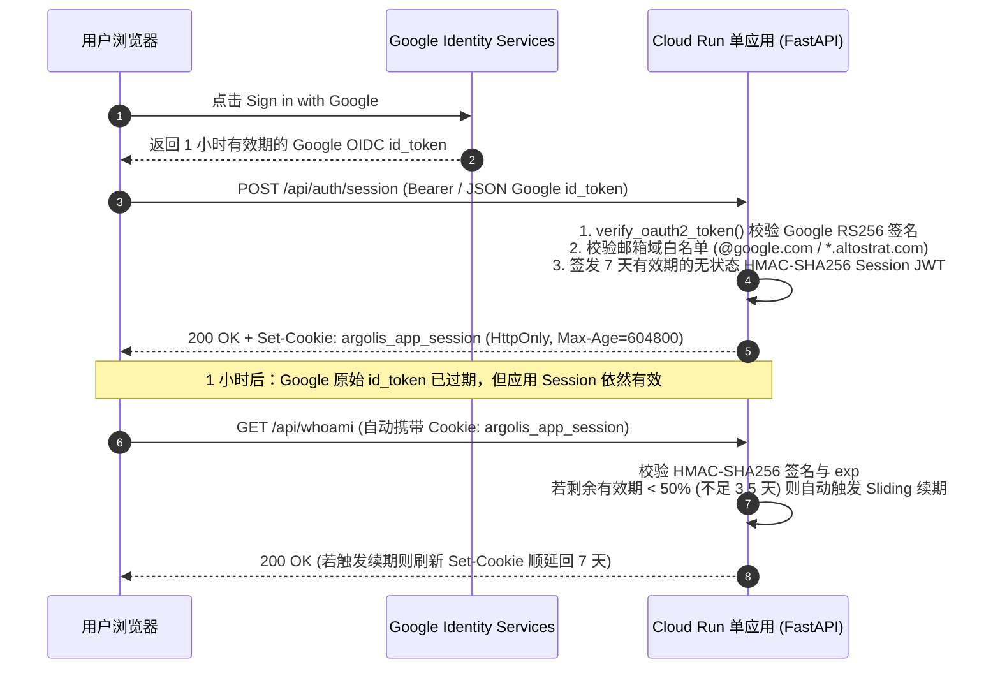

# Cloud Run 单应用 Google 域名登录 + 无状态长效 Session 与滑动续期 (`cloudrun-session-domain-auth`)

**Skill 简介**：为单个独立 Cloud Run Web 应用集成“Google 登录 + 邮箱域名白名单 + 无状态长效 Session（7～30天）+ 滑动自动续期”访问控制（无需部署负载均衡器 ALB，替代 IAP）。解决原生 Google Identity Services (GIS) OIDC `id_token` 固定 1 小时（3600s）硬性过期导致频繁掉线的问题，支持跨组织放行 `@google.com` 与通配子域 `*.altostrat.com`，兼容容器缩容至 0（Scale-to-Zero）与多实例水平扩容。

---

## 1. 适用场景与痛点背景

在跨组织演示或沙箱环境（同时向 `@google.com` 与 `@*.altostrat.com` 开放）中部署**单个独立 Cloud Run 应用**（不想承担 Global External ALB 负载均衡器的固定费用与配置复杂度）时：

1. **为什么不用原生 Cloud Run IAP？**
   - IAP 的 IAM 绑定不支持 `*.altostrat.com` 通配符子域，且容易触发跨组织 Domain Restricted Sharing 或 IAP Error Code 53 拦截。
2. **为什么不能直接拿 Google GIS 的 `id_token` 当长期会话凭证？**
   - 根据 Google 官方规范（Token types — User ID tokens 与 Sign In With Google Reference），Google 签发的 OIDC `id_token` 因无法被吊销，有效期被 Google 服务端硬编码锁定为 **1 小时（3600 秒）**。直接每次验 `id_token` 会导致用户每满 1 小时必定掉线重登。
3. **本 Skill 的核心机制（一次验签 + 换发长效无状态 Session + 滑动续期）**：
   - **首次登录换票（`POST /api/auth/session`）**：前端通过 GIS 获取 1 小时有效期的 Google `id_token` 后发给后端，后端调用 `verify_oauth2_token()` 验证 Google 签名及邮箱域名白名单，随后用应用固化的 `SESSION_SECRET`（HMAC-SHA256）签发一枚 **7 天（默认 604800 秒，可配 30 天）** 的无状态 Session JWT，并通过 `HttpOnly; Secure; SameSite=Lax` Cookie（及 JSON Body）下发。
   - **跨实例与 Scale-to-Zero 100% 持久**：由于采用自包含 HMAC 签名 Cookie 且 `SESSION_SECRET` 固化在 Cloud Run 环境变量中，无需挂 Redis 或数据库，即使容器缩容到 0 再冷启动，已登录用户的 7～30 天会话依然有效。
   - **滑动窗口自动续期（Sliding Session）**：当用户访问受保护接口且剩余有效期低于阈值（默认 `< 50%`，即不足 3.5 天）时，后端自动在响应头刷新 `Set-Cookie` 将有效期重新顺延回完整的 7 天，实现活跃用户“永不掉线”。



> **Note — 与 [`cloudrun-google-domain-auth`] 技能的选型分工**：
> - 若你有 **多个 Cloud Run 子应用 / 统一门户（Portal）** 且希望隐藏后端 `*.run.app` 公网入口、实现跨子域单点登录（SSO），请使用 [`cloudrun-google-domain-auth`] 的 **模式 B（Global ALB + Service Extensions `ext_proc`）**（详见 [`references/alb-service-extension-spec.md`]）。
> - 若你只部署 **1 个独立 Cloud Run 应用**、不想建负载均衡器，但又需要 **7～30 天长效免登与自动续期**，请使用本 Skill（`cloudrun-session-domain-auth`）。

---

## 2. 前置步骤：确认 OAuth Client ID（必选交互步骤）

根据 Google Identity 安全策略（`go/oauth-config-policy`），跨组织（External + In production）的 Web OAuth Client ID 只能在 Google Cloud Console 手动创建与配置。部署前 Agent **必须**使用 `ask_question` 引导用户选择：

- **选项 A（推荐）：复用已有的 Web OAuth Client ID**
  - 请用户提供已有的 `<PROJECT_NUMBER>-<HASH>.apps.googleusercontent.com`。
  - 部署完成后，提醒用户前往 **Google Auth Platform > Clients**（`https://console.cloud.google.com/auth/clients`，切换到该 Client ID 所属项目），在 **Authorized JavaScript origins** 中点击 **"+ Add URI"** 追加新应用的 Cloud Run URL（如 `https://<service>-<project_num>.<region>.run.app`，无尾斜杠 `/`）。
- **选项 B：新建 Web OAuth Client ID**
  - 引导用户在 **Google Auth Platform > Audience** 将 User Type 设为 **External** 并发布为 **In production**；
  - 在 **Google Auth Platform > Clients** 创建 **Web application** 客户端，将 Cloud Run URL 填入 Authorized JavaScript origins。

---

## 3. 标准代码实现模板（FastAPI + PyJWT 无状态长效 Session）

### 3.1 `requirements.txt`

```text
fastapi>=0.115.0
uvicorn[standard]>=0.32.0
google-auth>=2.35.0
requests>=2.32.0
PyJWT>=2.9.0
```

### 3.2 后端完整模板 (`main.py`)

已内置以下生产级加固特性：
1. **自定义安全 Cookie 提取器 (`extract_cookie_token`)**：严禁使用 Python 标准库 `http.cookies.SimpleCookie`（因为 Google GIS 会在同域下写入含未转义双引号的 `g_state={"i_l":0}`，导致 `SimpleCookie` 解析中断丢弃后面的 Session Cookie）。
2. **防 GIS 登录弹窗卡死**：HTML 页面响应强制附带 `cross-origin-opener-policy: same-origin-allow-popups`，前端回调延迟 80ms 后异步调用 `POST /api/auth/session` 换票。
3. **三模兼容鉴权依赖 (`require_session`)**：同时兼容 ALB 网关头（`x-authenticated-user-email`）、长效 `HttpOnly` Session Cookie / Bearer Token（含滑动自动续期），以及原生 Google `id_token` 自动升级换票。

```python
"""Single-App Cloud Run Google Domain Auth with Long-Lived Stateless Session & Sliding Renewal."""

import fnmatch
import html
import os
import time
from typing import Any

from fastapi import Depends, FastAPI, HTTPException, Request, Response
from fastapi.responses import HTMLResponse, JSONResponse, RedirectResponse
from google.auth.transport import requests as ga_requests
from google.oauth2 import id_token as g_id_token
import jwt
from pydantic import BaseModel

app = FastAPI()

APP_AUTH = os.getenv("APP_AUTH", "1") == "1"
OAUTH_CLIENT_ID = os.getenv("OAUTH_CLIENT_ID", "").strip()
SESSION_SECRET = os.getenv("SESSION_SECRET", "").strip()
COOKIE_NAME = os.getenv("COOKIE_NAME", "argolis_app_session").strip()
SESSION_TTL_SECONDS = int(os.getenv("SESSION_TTL_SECONDS", "604800"))  # 默认 7 天 (604800秒)
SESSION_RENEW_RATIO = float(os.getenv("SESSION_RENEW_RATIO", "0.5"))   # 剩余有效期低于 50% 时自动续期
ALLOWED_DOMAINS = [
    d.strip().lower()
    for d in os.getenv("ALLOWED_DOMAINS", "google.com,*.altostrat.com").split(",")
    if d.strip()
]

_GOOGLE_REQUEST = ga_requests.Request()


class SessionExchangeRequest(BaseModel):
  credential: str


def _now() -> int:
  return int(time.time())


def is_domain_allowed(email: str) -> bool:
  if not email or "@" not in email:
    return False
  domain = email.rsplit("@", 1)[-1].lower()
  for pattern in ALLOWED_DOMAINS:
    if pattern.startswith("*."):
      suffix = pattern[2:]
      if domain == suffix or domain.endswith("." + suffix):
        return True
    elif fnmatch.fnmatch(domain, pattern):
      return True
  return False


def extract_cookie_token(raw_cookie_header: str, cookie_name: str) -> str:
  """按分号安全提取目标 Cookie，避免 GIS 写入的 g_state={"i_l":0} 搞崩标准库 SimpleCookie。"""
  if not raw_cookie_header:
    return ""
  for chunk in raw_cookie_header.split(";"):
    part = chunk.strip()
    if "=" not in part:
      continue
    k, v = part.split("=", 1)
    if k.strip() == cookie_name and v.strip():
      return v.strip()
  return ""


def create_session_jwt(email: str, name: str = "", now_ts: int | None = None) -> dict[str, Any]:
  if not SESSION_SECRET:
    raise HTTPException(503, "SESSION_SECRET is not configured on the server.")
  iat = now_ts if now_ts is not None else _now()
  exp = iat + SESSION_TTL_SECONDS
  payload = {
      "sub": email,
      "email": email,
      "name": name or email,
      "iat": iat,
      "exp": exp,
      "type": "app_session",
  }
  token = jwt.encode(payload, SESSION_SECRET, algorithm="HS256")
  return {"token": token, "payload": payload}


def verify_session_jwt(token_str: str, now_ts: int | None = None) -> dict[str, Any] | None:
  if not SESSION_SECRET or not token_str:
    return None
  try:
    claims = jwt.decode(
        token_str,
        SESSION_SECRET,
        algorithms=["HS256"],
        options={"verify_exp": False},
    )
    now_val = now_ts if now_ts is not None else _now()
    if int(claims.get("exp", 0)) <= now_val or claims.get("type") != "app_session":
      return None
    return claims
  except jwt.PyJWTError:
    return None


def set_session_cookie(response: Response, token: str, max_age: int) -> None:
  response.set_cookie(
      key=COOKIE_NAME,
      value=token,
      max_age=max_age,
      path="/",
      httponly=True,
      secure=True,
      samesite="lax",
  )


def verify_google_id_token(id_token_str: str) -> dict[str, Any]:
  if not OAUTH_CLIENT_ID:
    raise HTTPException(503, "OAUTH_CLIENT_ID is not configured.")
  try:
    idinfo = g_id_token.verify_oauth2_token(
        id_token_str, _GOOGLE_REQUEST, OAUTH_CLIENT_ID
    )
  except Exception as exc:
    raise HTTPException(401, f"Invalid or expired Google ID token: {exc}") from exc

  email = (idinfo.get("email") or "").strip().lower()
  if not idinfo.get("email_verified") or not is_domain_allowed(email):
    raise HTTPException(403, f"Domain of '{email}' is not allowed.")
  return {
      "email": email,
      "name": idinfo.get("name") or email,
      "sub": idinfo.get("sub") or email,
  }


async def require_session(request: Request, response: Response) -> dict[str, Any]:
  # 1. 若未来挂载在 ALB + LbTrafficExtension 网关后，自动信任网关注入头
  gw_email = request.headers.get("x-authenticated-user-email", "").strip().lower()
  if gw_email and is_domain_allowed(gw_email):
    return {
        "email": gw_email,
        "name": request.headers.get("x-authenticated-user-name", gw_email),
        "auth_source": "alb_gateway",
        "iat": None,
        "exp": None,
        "remaining_seconds": None,
        "renewed": False,
    }

  if not APP_AUTH:
    return {
        "email": "auth-disabled@local",
        "name": "Auth Disabled",
        "auth_source": "disabled",
        "iat": None,
        "exp": None,
        "remaining_seconds": None,
        "renewed": False,
    }

  # 2. 优先校验长效 Session Cookie 或 Authorization: Bearer <app_session_jwt>
  cookie_token = extract_cookie_token(request.headers.get("cookie", ""), COOKIE_NAME)
  auth_header = request.headers.get("authorization", "")
  bearer_token = (
      auth_header[7:].strip() if auth_header.lower().startswith("bearer ") else ""
  )

  now_val = _now()
  for source_name, candidate in (("session_cookie", cookie_token), ("session_bearer", bearer_token)):
    if not candidate:
      continue
    claims = verify_session_jwt(candidate, now_ts=now_val)
    if claims:
      email = (claims.get("email") or "").lower()
      if not is_domain_allowed(email):
        raise HTTPException(403, f"Domain of '{email}' is no longer allowed.")
      exp = int(claims["exp"])
      iat = int(claims.get("iat", now_val))
      remaining = exp - now_val
      renewed = False

      # 滑动窗口自动续期：当剩余有效期不足阈值（默认 50%）时，自动重新签发并顺延回完整周期
      if remaining < int(SESSION_TTL_SECONDS * SESSION_RENEW_RATIO):
        minted = create_session_jwt(
            email=email, name=claims.get("name", email), now_ts=now_val
        )
        set_session_cookie(response, minted["token"], SESSION_TTL_SECONDS)
        response.headers["x-session-renewed"] = "true"
        response.headers["x-session-token"] = minted["token"]
        iat = minted["payload"]["iat"]
        exp = minted["payload"]["exp"]
        remaining = exp - now_val
        renewed = True

      return {
          "email": email,
          "name": claims.get("name", email),
          "auth_source": source_name,
          "iat": iat,
          "exp": exp,
          "remaining_seconds": remaining,
          "renewed": renewed,
      }

  # 3. 兼容降级：若客户端直接传了 1 小时的 Google ID Token，验签后自动升级下发长效 Session Cookie
  if bearer_token:
    google_user = verify_google_id_token(bearer_token)
    minted = create_session_jwt(
        email=google_user["email"], name=google_user["name"], now_ts=now_val
    )
    set_session_cookie(response, minted["token"], SESSION_TTL_SECONDS)
    response.headers["x-session-renewed"] = "true"
    response.headers["x-session-token"] = minted["token"]
    return {
        "email": google_user["email"],
        "name": google_user["name"],
        "auth_source": "google_id_token_upgraded",
        "iat": minted["payload"]["iat"],
        "exp": minted["payload"]["exp"],
        "remaining_seconds": SESSION_TTL_SECONDS,
        "renewed": True,
    }

  raise HTTPException(401, "Missing or expired session. Please sign in with Google.")


@app.post("/api/auth/session")
async def exchange_session(body: SessionExchangeRequest, response: Response):
  """将 1 小时有效期的 Google ID Token 换签为多日有效的无状态应用 Session。"""
  google_user = verify_google_id_token(body.credential)
  minted = create_session_jwt(email=google_user["email"], name=google_user["name"])
  set_session_cookie(response, minted["token"], SESSION_TTL_SECONDS)
  return {
      "ok": True,
      "email": google_user["email"],
      "name": google_user["name"],
      "session_token": minted["token"],
      "expires_in": SESSION_TTL_SECONDS,
      "exp": minted["payload"]["exp"],
  }


@app.post("/api/auth/logout")
@app.get("/api/auth/logout")
async def logout(request: Request):
  resp = RedirectResponse(url="/", status_code=302) if request.method == "GET" else JSONResponse({"ok": True})
  resp.delete_cookie(key=COOKIE_NAME, path="/", httponly=True, secure=True, samesite="lax")
  return resp


@app.get("/api/whoami")
async def whoami(session: dict[str, Any] = Depends(require_session)):
  return {
      "ok": True,
      "user": session["email"],
      "name": session["name"],
      "auth_source": session["auth_source"],
      "iat": session["iat"],
      "exp": session["exp"],
      "remaining_seconds": session["remaining_seconds"],
      "sliding_renewed": session["renewed"],
      "configured_ttl_seconds": SESSION_TTL_SECONDS,
  }


@app.get("/health")
async def health():
  # 注意：GFE 会拦截 *.run.app 的 /healthz 返回 404，健康检查请统一使用 /health
  return {"ok": True}
```

### 3.3 前端 GIS 登录与换票集成要点

1. **返回首页 HTML 时必须附带 `cross-origin-opener-policy: same-origin-allow-popups` 响应头**：
   ```python
   return HTMLResponse(
       content=html_content,
       headers={
           "cross-origin-opener-policy": "same-origin-allow-popups",
           "cache-control": "no-store",
       },
   )
   ```
2. **前端 JS 在 GIS 回调中延迟 80ms 调用 `POST /api/auth/session` 换取长效 Cookie**：
   ```javascript
   google.accounts.id.initialize({
     client_id: CLIENT_ID,
     ux_mode: "popup",
     callback: (resp) => {
       setTimeout(async () => {
         const r = await fetch("/api/auth/session", {
           method: "POST",
           headers: { "Content-Type": "application/json" },
           credentials: "same-origin",
           body: JSON.stringify({ credential: resp.credential })
         });
         if (r.ok) {
           // 此时浏览器已种下 7~30 天的 HttpOnly Cookie (argolis_app_session)
           window.location.reload();
         }
       }, 80);
     }
   });
   ```

---

## 4. 部署与更新规范（保持 `SESSION_SECRET` 稳定不掉线）

### 4.1 首次部署（或自动复用已有 `SESSION_SECRET`）

为了防止每次重新部署代码时随机生成新的 `SESSION_SECRET` 导致所有已登录用户的 Cookie 失效，部署脚本应先尝试读取线上已有的 `SESSION_SECRET`，仅在首次部署为空时才生成新密钥：

```bash
export PROJECT_ID="<YOUR_PROJECT_ID>"
export REGION="<YOUR_REGION>"
export SERVICE_NAME="<YOUR_SERVICE_NAME>"
export OAUTH_CLIENT_ID="<YOUR_OAUTH_CLIENT_ID>"
export SESSION_TTL_SECONDS="604800" # 7天=604800，30天=2592000（浏览器硬上限为400天=34560000）

# 若线上服务已存在 SESSION_SECRET 则直接复用，否则生成新的 32 字节密钥
EXISTING_SECRET=$(gcloud run services describe "${SERVICE_NAME}" \
  --region="${REGION}" --project="${PROJECT_ID}" \
  --format="value(spec.template.spec.containers[0].env)" 2>/dev/null \
  | grep -oP "(?<='SESSION_SECRET', 'value': ')[^']+" || true)

export SESSION_SECRET="${EXISTING_SECRET:-$(python3 -c 'import secrets; print(secrets.token_hex(32))')}"

gcloud run deploy "${SERVICE_NAME}" \
  --source . \
  --region "${REGION}" \
  --project "${PROJECT_ID}" \
  --allow-unauthenticated \
  --set-env-vars "^@^APP_AUTH=1@OAUTH_CLIENT_ID=${OAUTH_CLIENT_ID}@SESSION_SECRET=${SESSION_SECRET}@SESSION_TTL_SECONDS=${SESSION_TTL_SECONDS}@ALLOWED_DOMAINS=google.com,*.altostrat.com"
```

### 4.2 单独调整 Session 过期时间（零代码改动秒级生效）

若后续想把单应用的登录态从 7 天调整为 30 天（2592000 秒），只需执行：

```bash
gcloud run services update "${SERVICE_NAME}" \
  --region="${REGION}" \
  --project="${PROJECT_ID}" \
  --update-env-vars="SESSION_TTL_SECONDS=2592000"
```

---

## 5. 端到端验证清单（Verification Checklist）

部署完成后，Agent **必须**执行以下 4 项验证：

1. **COOP 防弹窗卡死头检查**：`curl -sI "https://<SERVICE_URL>/" | grep -i "cross-origin-opener-policy"` 必须包含 `same-origin-allow-popups`。
2. **未授权拦截检查**：`curl -s -o /dev/null -w "%{http_code}" "https://<SERVICE_URL>/api/whoami"` 必须返回 `401`。
3. **跨 1 小时保活验证**：签发一枚 `iat = now - 7200`（模拟 2 小时前登录，即原 Google `id_token` 已过期 1 小时）且 `exp = iat + SESSION_TTL_SECONDS` 的 Session Cookie 请求 `/api/whoami`，必须返回 `200 OK`。
4. **滑动窗口自动续期验证**：签发一枚 `iat = now - (SESSION_TTL_SECONDS * 0.6)`（剩余有效期 `< 50%`）的 Session Cookie 请求 `/api/whoami`，响应头必须包含 `x-session-renewed: true` 与新的 `Set-Cookie`，且返回的 `remaining_seconds` 恢复为完整的 `SESSION_TTL_SECONDS`。
